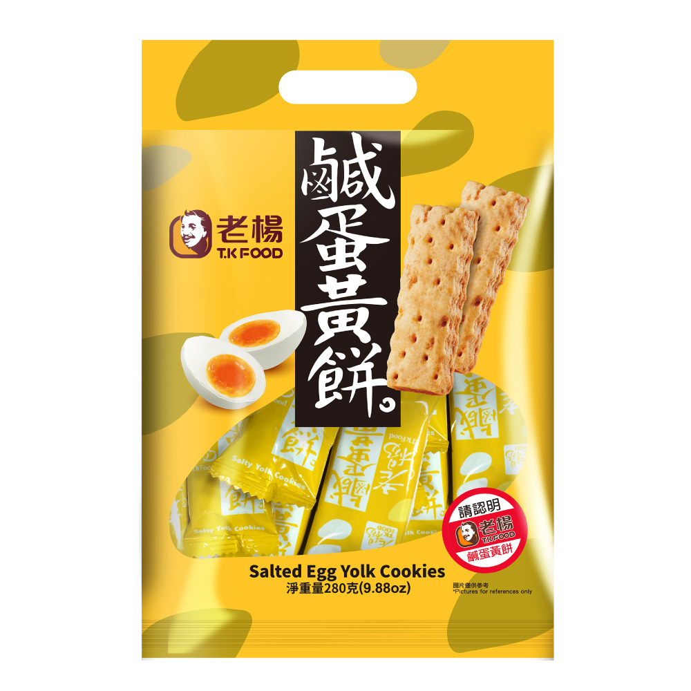
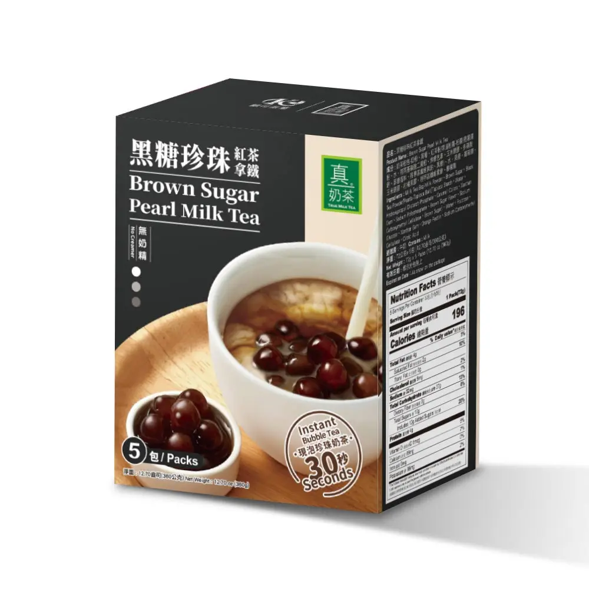
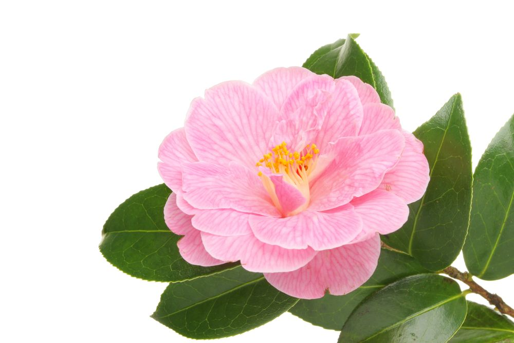
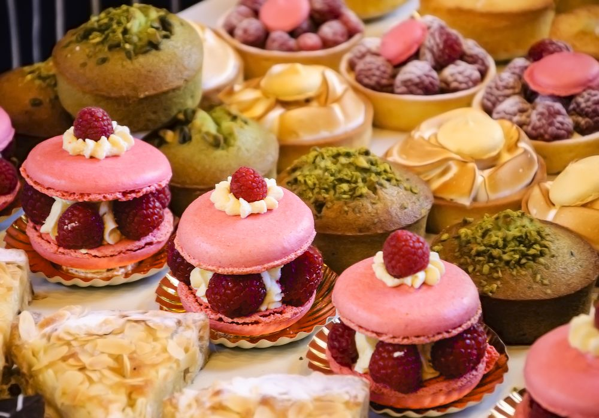
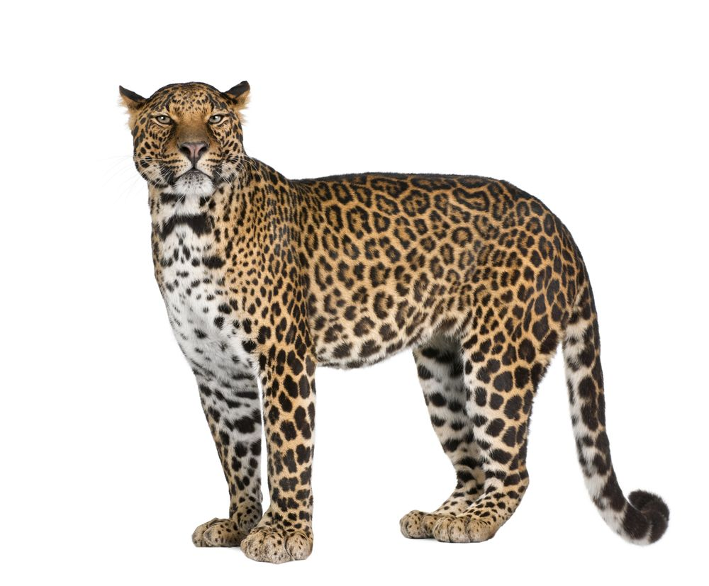
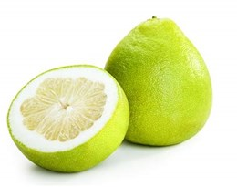
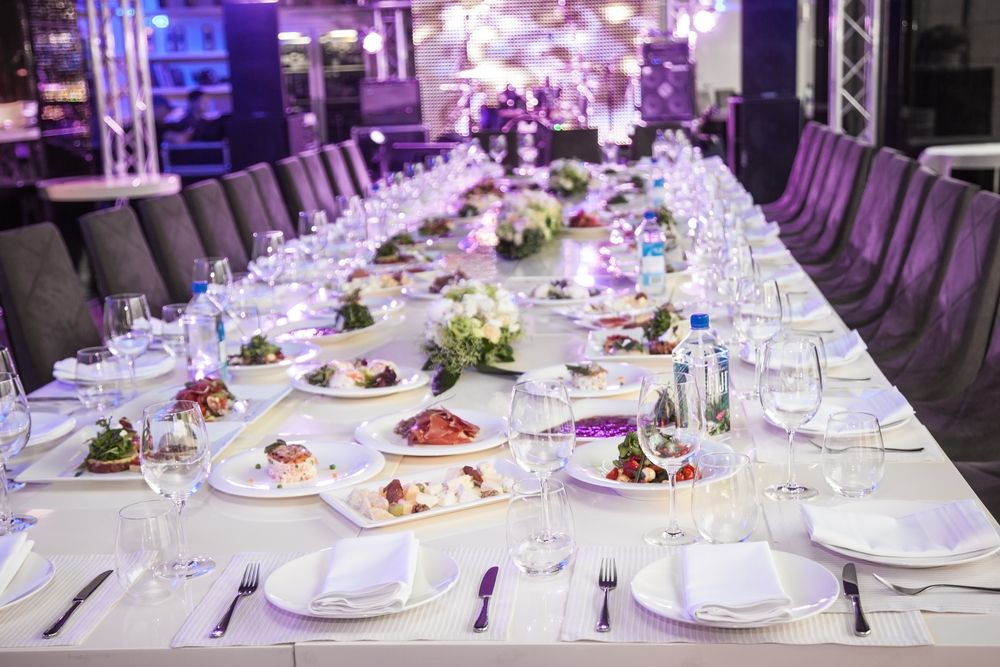

# Twitch streamer records (continued)

## playing games

| title | Chinese | co-op | date | official website | platform/channel | download | continuation |
|-------|---------|-------|------|------------------|------------------|----------|--------------|
|       |         |       |      |                  |                  |          |              |

### playing offline non-electronic games

| game | Chinese | venue* | co-op | date | preparation | format |
|------|---------|-------------------|-------|------|-------------|--------|
|      |         |                   |       |      |             |        |

## outdoors

### Taiwan

| place                                                                                               | Chinese  | co-op               | date              | category* | rating | keywords                                                                                                                                                                                                                                                                                                                  | situation                      |
|-----------------------------------------------------------------------------------------------------|----------|---------------------|-------------------|----------------------|--------|---------------------------------------------------------------------------------------------------------------------------------------------------------------------------------------------------------------------------------------------------------------------------------------------------------------------------|--------------------------------|
| Section 2, Nanjing East Road, Zhongshan district, Taipei city                                       |          | @mmgeneral          | October 2, 2026   | 1                    |        | @[Hutong Yakiniku 胡同燒肉](https://gyenhutong.com.tw/) @[誠品生活 eslite spectrum*](https://www.eslitespectrum.com/) @[Lady Kelly patisserie*](https://www.ladykelly.com.tw/) @lottery                                                                                                             | @gathering @restaurant @dating |
| Minsheng East Road, Zhongshan District, Taipei City                                                 |          | @mmgeneral          | October 27, 2026  | 1                    | 6/10   | @客蒸湘 Ke Zheng Xiang @[eslite 誠品](https://www.eslitecorp.com/) @[新光三越 Shin Kong Mitsukoshi](https://www.skm.com.tw/) @[Yves Saint Laurent](https://www.ysl.com) @[hermes - Paris](https://www.hermes.com/) @[Tom Ford](https://www.tomford.com/) @[Coach](https://www.coach.com) @[SUQQU](https://www.suqqu.com/) | @restaurant @birthday present  |
| Yuanshan, Datong District, Taipei City                                                              |          | @mmgeneral          | October 31, 2026  | 3                    |        | @Halloween🎃 @cosplay @Alien ghost hugging human                                                                                                                                                                                                                                                                          | @Halloween                     |
| Elephant Mountain, Xinyi District, Taipei City                                                      |          | @mmgeneral          | November 8, 2026  | 9                    |        | @四獸山 (🐘elephant -> 🦁Lion -> 🐆leopard\* -> 🐯tiger) elephant mountain hiking trail @towel\* @popsicle\* @sunscreen @firefly paradise\* @sunset @(大直美堤)火舞 Fire performance at Meiti Riverside Park @[黑毛屋 Kurogeya](https://www.daily.kurogeya.com.tw/)           | @fitness @tour                 |
| [Eatogether](https://www.eatogether.com.tw), 6F, No. 12, Songshou Road, Xinyi District, Taipei City | 饗食天堂 | @mmgeneral @eat1025 | November 10, 2026 | 1,5                  |        | @Caesar salad 凱薩沙拉 @酥皮濃湯 Puff pastry\* corn soup @[McLaren Mastercard Formula* 1 Team](https://www.mclaren.com/racing/formula-1/)                                                                                                                                                           | @buffet                        |

## what I don't know about Taiwan

### About hand-shaken drinks

| brand                                                 | Chinese  | recommendation                                                                                                                                                                  |
|-------------------------------------------------------|----------|---------------------------------------------------------------------------------------------------------------------------------------------------------------------------------|
| [Unique Green](https://www.uniquegreentea.com/)       | UG       | UG奶茶-茶花紅烏龍·奶茶 UG rich milk tea - Camellia\* Red Oolong Tea / NT\$75 (L) 金杯蜜香紅/UG奶茶 Golden Cup Honey Aroma* Black Tea / NT\$70 (L) |
| [Ten Ren's Tea - CHAFFEE](https://www.tenren.com.tw/) | 天仁茗茶 | 四季烏龍 Four Seasons Oolong Tea / NT\$60 (L) 晨露茉莉綠茶 Jasmine Green Tea / NT\$60 (L)                                                                                   |
| [ComeBuy](https://www.comebuy2002.com.tw/)            |          | 文山包種 Wenshan Pouchong Oolong Tea / NT\$50 (L)                                                                                                                               |
| [Hanlin tea room](https://www.hanlin-tea.com.tw/)     | 翰林茶館 | 國宴珍奶 State Banquet* Class Bubble Milk Tea / NT\$143 (L) 翰林奶茶 Black Milk Tea / NT\$80 (M)                                                                 |
| [Peak Tea](https://peak-tea.com/)                     | 青山     | 冬青 Winter Tea / NT\$65 (L)                                                                                                                                                    |

### About Taiwan Snacks

| name                                                                        | Chinese                                                     | image                                                                                                                                                                               | category           |
|-----------------------------------------------------------------------------|-------------------------------------------------------------|-------------------------------------------------------------------------------------------------------------------------------------------------------------------------------------|--------------------|
| [T.K Food](https://www.tkfood.com.tw/) Salted egg yolk* cookies  | 老楊鹹蛋黃餅                                                |                                                                                                                | square cookies     |
| [OK Tea](https://www.oktea.tw/): True milk tea - Brown sugar pearl milk tea | [歐可茶葉](https://www.oktea.tw/) - 真奶茶·黑糖珍珠紅茶拿鐵 | <!-- https://s2.eslite.com/unsafe/s.eslite.com/upload/product/o/2681982468002/20210219042048141514.jpg --> | instant bubble tea |

### About Taiwan transportation

| transportation | method | feature | website |
|----------------|--------|---------|---------|
|                |        |         |         |

### convenient life

| facility                                          | Chinese    | feature                           | usage                                                                    |
|---------------------------------------------------|------------|-----------------------------------|--------------------------------------------------------------------------|
| Watsons                                           | 屈臣氏     | personal care and beauty retailer | <https://www.watsons.com.hk/>                                            |
| [Miramar Cinemas](https://www.miramarcinemas.tw/) | 美麗華影城 | Dolby Cinema / IMAX theater       | online ticket booking supported, classification for different age groups |

### brand in Taiwan

| brand                                           | Chinese     | category      | sample/price                                                                                                                                                                                              |
|-------------------------------------------------|-------------|---------------|-----------------------------------------------------------------------------------------------------------------------------------------------------------------------------------------------------------|
| [Duracell](https://duracell.com/)               | 金頂/金霸王 | battery       | AA4 長效電力保證 3號/4粒裝/鹼性電池 / NT\$139 AAA4 長效電力保證 4號/4粒裝/鹼性電池 / NT\$139                                                                                                          |
| [Hoka](https://www.hoka.com)                    |             | running shoes | [Women's Bondi 9 / \$175](https://www.hoka.com/en/us/womens-everyday-running-shoes/bondi-9/1162012.html) [Men's Bondi 7 / \$165](https://www.hoka.com/en/us/all-gender-footwear/bondi-7/1110518.html) |
| [Hooters*](https://www.hooters.com/) |             | restaurant    |                                                                                                                                                                                                           |

### About Taiwan payment

| method | Chinese | website |
|--------|---------|---------|
|        |         |         |

### terms used in Taiwan

| term   | meaning        | description           |
|--------|----------------|-----------------------|
| 真理褲 | dolphin shorts | a type of short pants |

## About Taiwan Education

### University

| university | Chinese | abbr. | website | location |
|------------|---------|-------|---------|----------|
|            |         |       |         |          |

## missing skills

### humorous

| topic | joke | pun* |
|-------|------|-----------------|
|       |      |                 |

## interesting topic

| topic                                                                            | pro                                                 | con*                                                                       | discussion                                         | solution  |
|----------------------------------------------------------------------------------|-----------------------------------------------------|---------------------------------------------------------------------------------------|----------------------------------------------------|-----------|
| birthday in September or October                                                 | -                                                   | after the start of the new school year, not familiar enough with your new classmates. | no one celebrates your birthday in the first year. | next year |
| Is it appropriate to use money to attract a girl before starting a relationship? | you have a chance when your only advantage is money | only attract a gold digger (拜金主义者)                                               |                                                    |           |

## Profile

| character          | value                                                                                                     | note              |
|--------------------|-----------------------------------------------------------------------------------------------------------|-------------------|
| real-name          | @[eat1025](https://www.twitch.tv/eat1025)                                                                 | Miss Zhong 鍾欣語 |
| nearby street/road | Siyuan Road, Xinzhuang District, New Taipei City 新北市新莊區思源路                                       |                   |
| nearby MRT Station | [Circular* Line](https://www.ntmetro.com.tw/basic/?node=10069) Xingfu Station 幸福捷運站       |                   |
| nearby bus stop    | [652](https://ebus.gov.taipei/MapOverview?nid=0100065200) Touqian Junior* High School 頭前國中 |                   |

> [!TIP]
> __*__:
>
> - venue: [N-Count] the `venue` for an event or activity is the place where it will happen. （事件或活动的）发生地，举办地点;场地
> - category: 1=restaurant, 2=exhibition, 3=show, 4=handmade, 5=gathering, 6=tour, 7=anniversary, 8=birthday (the anniversary of the date on which you were born) 9=hike
> - pun: a `pun` is a clever and amusing use of a word or phrase with two meanings, or of words with the same sound but different meanings. 双关诙谐语；双关语 
>   if you `pun`, you try to amuse people by making a pun. 谐用双关语
> - yolk: [N-Var] the `yolk` of an egg is the yellow part in the middle. 蛋黄
> - con: [N] the written abbr. for `contra`, 相反(地);反对(地)
> - camellia: [N-Count] a `camellia` is a large bush that has shiny leaves and large white, pink, or red flowers similar to a rose. 山茶(树) 
>   
> - aroma: [N-Count] an `aroma` is a strong, pleasant smell. (食物等的)香味,芳香
> - spectrum: [N-Sing] `the spectrum` is the range of different colors which is produced when light passes through a glass prism or through a drop of water.
>   a rainbow shows the colors in the spectrum. 光谱 
>   [N-Count] a `spectrum` is a range of a particular type of thing. [usually singular] 系列;范围 
>   [N-Count] a `spectrum` is a range of light waves or radio waves within particular frequencies. 波谱(如光波波谱、无线电波波谱等)
> - Pâtisserie: [N-Count] a `patisserie` is a shop where cakes and pastries are sold. 糕点店 
>   [N-Uncounted] `patisserie` is cakes and pastries. 糕点 
>   
> - leopard: [N-Count] a `leopard` is a type of large, wild cat. leopards have yellow fur and black spots, and live in Africa and Asia. 豹🐆 
>  [Phrase] if you say that `a leopard cannot change its spots`, you mean that people or things are not able to change their basic characteristics, especially when you are critical of those characteristics. 本性难移;陋习难改 
>  snow leopard: 雪豹 leopard cat: 豹猫;山猫;狸猫 
>  
> - towel: [N-Count] a `towel` is a piece of thick soft cloth that you use to dry yourself. 毛巾 
>  [Verb] if you `towel` something or `towel` it dry, you dry it with a towel. 用毛巾擦(干) 
>  [Phrase] if you `throw in the towel`, you stop trying to do something because you realize that you cannot succeed. 承认失败;认输 [informal] 
>  bath towel: 浴巾 paper towel: 纸巾;厨用纸巾 hand towel: 毛巾;手巾;方巾;擦手巾 beach towel: 沙滩毛巾;大浴巾 kitchen towel: 厨房用纸;洗碗布 
>   tea towel: [N-Count] a `tea towel` is a cloth used to dry dishes after they have been washed. (擦干碗碟的)抹布,拭布,茶巾 [British] 
>   in AM, use `dish towel`.
> - Popsicle: [N-Count] a `Popsicle` is a piece of flavored ice or ice cream on a stick. 冰棍;棒冰;雪糕 [US, trademark] 
>  Popsicle Sundays: 冰棒星期天 Popsicle sticks: 冰棒棍
> - paradise: [N] according to some religions, `paradise` is a wonderful place where people go after they die, if they have led good lives. 天堂;天国 
>  [N-Var] you can refer to a place or situation that seems beautiful or perfect as `paradise` or `a paradise`. 乐园;福地;极美的地方 
>  [N-Count] you can use `paradise` to say that a place is very attractive to a particular kind of person and has everything they need for a particular activity. (特定人群的)天堂,胜地 
>  paradise lost: 失乐园 a paradise on earth: 人间天堂 earthly paradise: 地上乐园,人间天堂
> - puff: [Verb] if someone `puffs at` a cigarette, cigar, or pipe, they smoke it. 吸,抽(香烟等) 
>  [Verb] if you `puff` smoke or moisture from your mouth or if it `puffs` from your mouth, you breathe it out. 吹;喷;吐 
>  [Verb] if an engine, chimney, or boiler `puffs` smoke or steam, clouds of smoke or steam come out of it. (引擎、烟囱或锅炉)冒(烟或气) 
>  [N-Count] a `puff of` something such as air or smoke is a small amount of it that is blown out from somewhere. (吹出的)一缕,一股 
>  [Verb] if you `are puffing`, you are breathing loudly and quickly with your mouth open because you are out of breath after a lot of physical effort. 喘息;喘气 
>  [N-Count] a `puff for` something such as a book, film, product, or organization is something that is done or said in order to attract people's attention and tell them how good it is. 吹捧;吹嘘 [mainly US, informal] 
>  [N-Count] a `puff` is the same as a `poof`. 同poof [British, informal, offensive] 
>  love in a puff: 志明与春娇 powder puff: 粉扑 cream puff: 奶油松饼;奶油泡芙 puff pastry: 油酥皮;起酥皮 puff out: 吹灭;(使)膨胀;气喘吁吁地说 puff up: 使肿胀 puff on: (一口一口地)抽(烟斗、香烟🚬等)
> - pastry: [N-Uncounted] `pastry` is food made from flour, fat, and water that is mixed together, rolled flat, and baked in the oven. it is used, for example, for making pies. 油酥面团 
>  [N-Count] a `pastry` is a small cake made with sweet pastry. 油酥点心;油酥糕点 
>  puff pastry: 油酥皮;起酥皮 pastry cook: 糕点师;点心厨师 Danish Pastry: 早餐丹麦包;丹麦面包 French Pastry: 法式甜点 fruit puff pastry: 水果千层派 pastry bag: 挤花袋;裱花袋
> - formula: [N-Count] a `formula` is a plan that is invented in order to deal with a particular problem. 原则;规划;方案 
>  [N-Sing] a `formula for` a particular situation, usually a good one, is a course of action or a combination of actions that is certain or likely to result in that situation. 方案;方法 
>  [N-Count] a `formula` is a group of letters, numbers, or other symbols which represents a scientific or mathematical rule. 公式;方程式 
>  [N-Count] in science, the `formula` for a substance is a list of the amounts of various substances which make up that substance, or an indication of the atoms that it is composed of. 分子式;结构式 
>  [N-Uncounted] `formula` is used followed by a number to indicate a particular type of racing car or something relating to that type of car. (赛车的)级,方程式 
>  [N-Uncounted] `formula` is a powder which you mix with water to make artificial milk for babies. 配方奶;代乳品 
>  chemical formula: 化学式;分子式;化学公式;化学分子式 formula one: 一级方程式赛车 general formula: 通式;一般公式 infant formula: 婴儿配方;婴儿配方食品
> - pomelo: [N] a tropical rutaceous tree, grown widely in oriental regions for its large yellow fruit. 柚子 
>  
> - banquet: [N-Count] a `banquet` is a grand formal dinner. 宴会;盛宴 
>  the wedding banquet: 喜宴 banquet hall: 宴会厅;宴会大厅 return banquet: 答谢宴会 state banquet: 国宴 
>  
> - hooter: [N-Count] a `hooter` is a device such as a horn that makes a hooting noise. 喇叭;汽笛 [British, old-fashioned] 
>  alarm hooter: 报警笛 electric hooter: 电笛 horn hooter: 喇叭 a hooter: 喇叭 hooter noise: 喇叭噪声
> - circular: [Adjective] something that is `circular` is shaped like a circle. 圆的;圆形的 
>  [Adjective] a `circular` journey or route is one in which you go to a place and return by a different route. (旅程或路线)环形的,巡回的 
>  [Adjective] a `circular` argument or theory is not valid because it uses a statement to prove something which is then used to prove the statement. (论证或理论)循环论证的 
>  [N-Count] a `circular` is an official letter or advertisement that is sent to a large number of people at the same time. (同时发送给很多人的)广告印刷品,通告 
>  circular motion: 圆周运动 circular reference: 循环引用;循环依赖 circular hole: 圆孔
> - junior: [Adjective] a `junior` official or employee holds a low-ranking position in an organization or profession. 职位(或地位)较低的;年资较浅的 
>  [N-Sing] if you are someone's `junior`, you are younger than they are. 较年幼者;年少者 
>  [N-in-Names] `Junior` is sometimes used after the name of the younger of two men in a family who have the same name, sometimes in order to prevent confusion. the abbreviation `Jr` is also used. 小(用于男子名后以区别于家族中同名的长辈,缩略形式为Jr) [US] 
>  [N-Count] in the United States, a student in the third year of a high school or university course is called a `junior`. (美国高中或大学的)三年级学生 
>  junior accountant: 初级会计;初级会计员 junior high school: 初中;国民中学 junior middle school: 初中 junior suite: 简单套房;普通套房;小套房 formula junior: 初级方程式 
>  (Junior) 尤尼奥尔 (人名)

## Reference

- [T.K Food](https://www.tkfood.com.tw/)
- [Hutong Yakiniku](https://gyenhutong.com.tw/)
- [Watsons](https://www.watsons.com.hk/)
- [誠品生活 eslite spectrum](https://www.eslitespectrum.com/)
- [Lady Kelly pâtisserie](https://www.ladykelly.com.tw/)
- [eslite](https://www.eslite.com/)
- [The Hunger Games](https://www.imdb.com/title/tt1392170)
- [Owala Water Bottle](https://owalalife.com/)
