# daily English learning (Part 2)

Recently, I've been frequently encountering unfamiliar words when receiving messages.
Previously, I would simply look them up in a dictionary like [Eudic](https://dict.eudic.net/) to understand their meaning.
When I encounter similar words again, I get confused about their meanings. For example, "familiar" and "similar"

## glossary*

### morning news & weather

learned from [ChatGPT](https://chatgpt.com/) in Singapore.

- haze: [N-Var] `haze` is light mist, caused by particles of water or dust in the air, which prevents you from seeing distant objects clearly. haze often forms in hot weather. (阴)霾;雾霭 
  [N-Sing] if there is a `haze of` something such as smoke or steam, you cannot see clearly through it. 雾状物 [literary] 
  [N-Sing] if someone is in a `haze`, they are not thinking clearly or not really noticing what is happening around them. 迷糊😧;懵懂 [with supplement, oft adjective Noun, Noun of n]
- pollutant: [N-Var] `pollutants` are substances that pollute the environment, especially gases from vehicles and poisonous chemicals produced as waste by industrial processes. 污染物(尤指车辆尾气和工业有毒化学废弃物)
- deteriorate: [Verb] if something `deteriorates`, it becomes worse in some way. 恶化;变坏;衰退
- strenuous: [Adj-graded] a `strenuous` activity or action involves a lot of energy or effort. 费力的;繁重的;艰苦的
- pollution: [N-Uncounted] `pollution` is the process of polluting water, air, or land, especially with poisonous chemicals. (尤指有毒化学品造成的)污染 
  [N-Uncounted] `pollution` is poisonous or dirty substances that are polluting the water, air, or land somewhere. 污染物
- meteorological: [Adj.] `meteorological` means relating to meteorology. 气象学的 
  meteorology: [N-Uncounted] `meteorology` is the study of the processes in the Earth's atmosphere that cause particular weather conditions, especially in order to predict the weather. 气象学
- steady: [Adj-graded] a `steady` situation continues or develops gradually without any interruptions and is not likely to change quickly. 稳步的;持续不断的 
  [Adj-graded] if an object is `steady`, it is firm and does not shake or move about. 稳定的;牢固的;不摇晃的 
  [Adj-graded] if you look at someone or speak to them in a `steady` way, you look or speak in a calm, controlled way. 沉着的;镇定的;冷静的 
  [Adj-graded] if you describe a person as `steady`, you mean that they are sensible and reliable. (人)稳重的,理智的,可靠的 
  [V-T/V-I] if you `steady` something or if it `steadies`, it stops shaking or moving about. (使)稳定;(使)不摇晃 
  [Verb] if you `steady yourself`, you control your voice or expression, so that people will think that you are calm and not nervous. 使镇定;使冷静;使平静 
  [Exclamation] you say 'steady on' to someone to tell them to calm down or to be careful about what they are saying. 冷静点;说话当心点 
  [Phrase] if two people `are going steady`, they are having a long, fairly serious romantic relationship. 有确定的情侣关系;恋爱关系稳定 [informal]
- exclamation: [N-Count] an `exclamation` is a sound, word, or sentence that is spoken suddenly, loudly, or emphatically and that expresses excitement, admiration, shock, or anger. 惊叫;感叹;感叹词;感叹句
- monetary: [Adj.] `monetary` means relating to money, especially the total amount of money in a country. (尤指一国)货币的,金融的,财政的 [business]
- inflation: [N-Uncounted] `inflation` is a general increase in the prices of goods and services in a country. 通货膨胀 [business]

#### pollutant & pollution

- pollutant: [N-Var] `pollutants` are substances that pollute the environment, especially gases from vehicles and poisonous chemicals produced as waste by industrial processes. 污染物(尤指车辆尾气和工业有毒化学废弃物)
- pollution: [N-Uncounted] `pollution` is the process of polluting water, air, or land, especially with poisonous chemicals. (尤指有毒化学品造成的)污染 
  [N-Uncounted] `pollution` is poisonous or dirty substances that are polluting the water, air, or land somewhere. 污染物

#### calm & clam

- calm: [Adj-graded] a `calm` person does not show or feel any worry, anger, or excitement. 镇定的;镇静的;冷静的 
  [Verb] if you `calm` someone, you do something to make them feel less angry, worried, or excited. 使平静;使安静;使镇定 
  [N-Uncounted] `calm` is used to refer to a quiet, still, or peaceful atmosphere in a place. 平静;安静;宁静 
  [Adj-graded] if someone says that a place is `calm`, they mean that it is free from fighting or public disorder, when trouble has recently occurred there or had been expected. 平静的;安定的 [journalism] 
  [Verb] to `calm` a situation means to reduce the amount of trouble, violence, or panic there is. 平定;使安定;使有秩序 
  [Adj-graded] if the sea or a lake is `calm`, the water is not moving very much and there are no big waves. (水面)平静的,风平浪静的 
  [Adj-graded] `calm` weather is pleasant weather with little or no wind. (天气)无风的 
  [N-Count] in sailing, a flat `calm` or a dead `calm` is a condition of the sea or the weather in which there is very little wind or movement of the water. (帆船⛵️比赛中的)静风,风平浪静 [technical] 
  [Verb] when the sea `calms`, it becomes still because the wind stops blowing strongly. when the wind `calms`, it stops blowing strongly. (海面)平静;(风)平息 
  [Verb] to `calm` a pain or an itch means to reduce it or get rid of it. 镇(痛);止(痒) 
  [Phrase] you can use `the calm before the storm` to refer to a quiet period in which there is little or no activity, before a period in which there is a lot of trouble or intense activity. 风暴前的平静
- clam: [N-Count] `clams` are a kind of shellfish which can be eaten. 蛤;蚌;蛤蜊 
  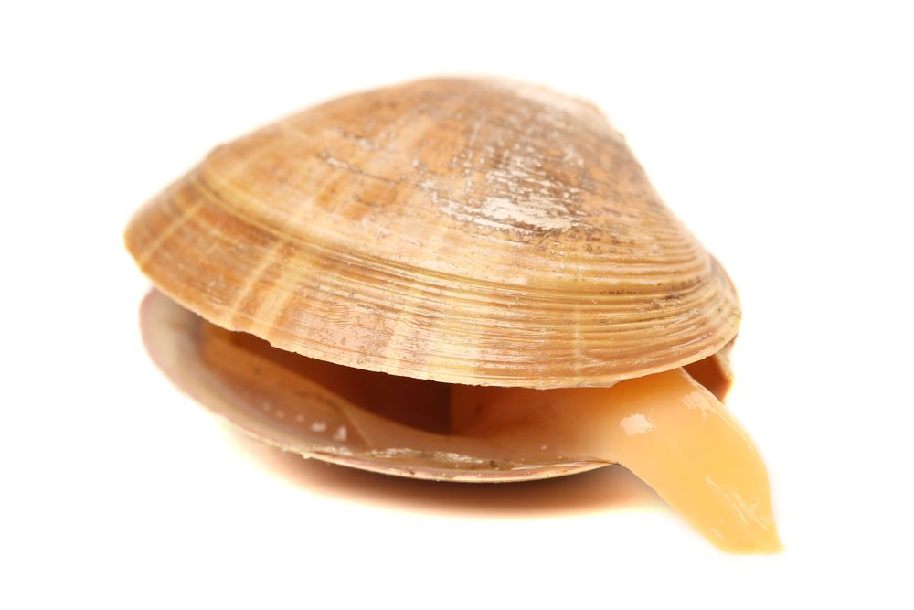

### traffic news

- facilitate: [Verb] to `facilitate` an action or process, especially one that you would like to happen, means to make it easier or more likely to happen. 促进;使便利
- grave: [N-Count] a `grave` is a place where a dead person is buried. 墓穴;坟墓🪦;埋葬处 
  [N-Count] you can refer to some-one's death as their `grave` or to death as `the grave`. 死亡;终结 
  [Adj-graded] a `grave` event or situation is very serious, important, and worrying. 严重的;重大的;严峻的 
  [Adj-graded] a `grave` person is quiet and serious in their appearance or behavior. 严肃的;表情沉重的 
  [Adj.] in some languages such as French, a `grave` accent is a symbol that is placed over a vowel in a word to show how the vowel is pronounced. 重音符;抑音符;沉音符 
  [Phrase] if you say that someone `is digging` their `own grave`, you are warning them that they are doing something foolish or dangerous that will cause their own failure. 自掘坟墓;自取灭亡 
  [Phrase] if you say that someone who is dead would `turn in` their `grave at` something that is happening now, you mean that they would be very shocked or upset by it, if they were alive. 九泉之下不得安宁
- sweep: [Verb] if you `sweep` an area of floor or ground, you push dirt or `rubbish` off it using a brush with a long handle. 扫;掸;打扫;清扫 
  [Verb] if you `sweep` things off something, you push them off with a quick smooth movement of your arm. 拂去;掸去 
  [Verb] if someone with long hair `sweeps` their hair into a particular style, they put it into that style. 梳,拢(头发) 
  [V-T/V-I] if your arm or hand `sweeps` in a particular direction, or if you `sweep` it there, it moves quickly and smoothly in that direction. (使)(手臂)挥动 
  [Verb] if wind, a stormy sea, or another strong force `sweeps` someone or something along, it moves them quickly along. (风、汹涌的海水🌊等)席卷,横扫,掠过 
  [Verb] if you `are swept` somewhere, you are taken there very quickly. 将...迅速送到 
  [Verb] if something `sweeps` from one place to another, it moves there extremely quickly. 扫过;掠过;疾驰而过 [written] 
  [Verb] if events, ideas, or beliefs `sweep` through a place, they spread quickly through it. (事件、思想💭、信仰)迅速传播,席卷 
  [Verb] if someone `sweeps` into a place, they walk into it in a proud, confident way, often when they are angry. (通常指生气时)大模大样地走,趾高气扬地走 [written] 
  [Verb] if a person or thing `sweeps` something `away` or `aside`, they remove it quickly and completely. 彻底删掉;迅速除去 
  [Verb] if lights or someone's eyes `sweep` an area, they move across the area from side to side. (目光)扫视;(灯光)扫过,掠过 [mainly written] 
  [Verb] if land or water `sweeps` somewhere, it stretches out in a long, wide, curved shape. 蜿蜒,延伸;绵延 
  [N-Count] a `sweep of` land or water forms a long, wide, curved shape. (道路、河流)绵延弯曲的地带,宽广而弯曲的一长段 [with supplement] 
  [Verb] if a person or group `sweeps` an election or `sweeps to` victory, they win the election easily. 轻松赢得(竞选等) 
  [N-Count] if someone makes a `sweep of` a place, they search it, usually because they are looking for people who are hiding or for an illegal activity. 搜查;搜索🔍;扫荡 [usually singular] 
  [N-Sing] if you refer to the `sweep of` something, you are indicating that it includes a large number of different events, qualities, or opinions. 广泛性;广度 [with supplement] 
  [Phrase] if someone `sweeps` something bad or wrong `under the carpet`, or if they `sweep` it `under the rug`, they try to prevent people from hearing about it. 掩盖;掩饰 
  [Phrase] if you `make a clean sweep of` something such as a series of games or tournaments, you win them all. 在(比赛中)大获全胜;横扫 
  [Phrase] if someone `sweeps` you `off` your `feet`, you fall in love with them very quickly because you find them very attractive or exciting. to `sweep the board` -> see: `board` 使一见倾心;把...一下子迷住🤩
- columbarium: [N] a niche for a funeral urn containing the ashes of the cremated dead 骨灰安置所
- glow: [N-Count] a `glow` is a dull, steady light, for example the light produced by a fire when there are no flames. 微弱稳定的光;暗淡的光 [usually singular] 
 [N-Sing] a `glow` is a pink color on a person's face, usually because they are healthy or have been exercising. (脸上的)红光,红晕,红润 
 [N-Sing] if you feel a `glow of` satisfaction or achievement, you have a strong feeling of pleasure because of something that you have done or that has happened. 一股,满腔(满足感等) 
 [Verb] if something `glows`, it produces a dull, steady light. 发微弱而稳定的光;发暗淡的光 
 [Verb] if a place `glows with` a color or a quality, it is bright, attractive, and colorful. 色彩鲜艳;绚丽夺目;洋溢着(某种特征) [also Verb] 
 [Verb] if something `glows`, it looks bright because it is reflecting light. 发光;泛光 
 [Verb] if someone's skin `glows`, it looks pink because they are healthy or excited, or have been doing physical exercise. (皮肤由于健康、激动或运动)发红,泛红晕,容光焕发 [also Verb] 
 [Verb] if someone `glows with` an emotion such as pride or pleasure, the expression on their face shows how they feel. 洋溢着,散发出(某种情感) [also Verb]
- moisture: [N-Uncounted] `moisture` is tiny drops of water in the air, on a surface, or in the ground. 潮气;湿气;水分
- grocery: [N-Count] a `grocery` or a `grocery store` is a grocer's shop. 食品杂货店 [mainly US] 
 [N-Plural] `groceries` are foods you buy at a grocer's or at a supermarket such as flour, sugar, and tinned foods. 食品杂货
- comprise: [Verb] if you say that something `comprises` or `is comprised of` a number of things or people, you mean it has them as its parts or members. 包括;由...组成 [formal] 
 [Verb] the things or people that `comprise` something are the parts or members that form it. 构成;组成 [formal] 
  compose: 正式用词,多用被动态. 指将两个或两个以上的人或物放到一起形成一个整体. 
  comprise: 正式用词,指整体是由几个独立的部分所组成. 
  consist: 与of连用,指一个整体由几个部分组成,或由某些材料构成. 
  constitute: 正式用词,指由某些部分组成一个整体或构成某物的基本成分. 在句中,主语表事物的组成部分,宾语表示事物的整体.
- precise: [Adj-graded] you use `precise` to emphasize that you are referring to an exact thing, rather than something vague. 明确的;确切的 [emphasis] 
 [Adj-graded] something that is precise is exact and accurate in all its details. 精确的;准确的 
 [Phrase] you say '`to be precise`' to indicate that you are giving more detailed or accurate information than you have just given. 确切地说;准确地说
- forfeit: [Verb] if you `forfeit` something, you lose it or are forced to give it up because you have broken a rule or done something wrong. (因违反规定等)被没收,丧失 
 [Verb] if you `forfeit` something, you give it up willingly, especially so that you can achieve something else. (尤指为获得他物)主动放弃 
 [N-Count] a `forfeit` is something that you have to give up because you have done something wrong. 罚金;没收物
- accumulate: [V-T/V-I] when you `accumulate` things or when they `accumulate`, they collect or are gathered over a period of time. 堆积;积累;积聚
- arena: [N-Count] an `arena` is a place where sports, entertainments, and other public events take place. it has seats around it where people sit and watch. 运动场;竞技场;体育场 
 [N-Count] you can refer to a field of activity, especially one where there is a lot of conflict or action, as an `arena` of a particular kind. 活动领域;舞台 
 (Arena) 阿里纳 (人名)

### [Twitch](https://www.twitch.tv/)

- stalker: [N-Count] a `stalker` is someone who keeps following or contacting someone else, especially a famous person or a person they used to have a relationship with, in an annoying and frightening way. 跟踪骚扰者(尤针对名人或分手恋人)
- jackpot: [N-Count] a `jackpot` is the most valuable prize in a game or lottery, especially when the game involves increasing the value of the prize until someone wins it. (游戏或彩票的)头奖,最高奖;(尤指游戏中的)累积赌注金 [usually singular] 
  [Phrase] if you `hit the jackpot`, you have a great success, for example by winning a lot of money or having a piece of good luck. 取得巨大成功;赢了一大笔钱;交好运 [informal]
- tingle: [Verb] when a part of your body `tingles`, you have a slight stinging feeling there. 感到刺痛 
  [Verb] if you `tingle with` a feeling such as excitement, you feel it very strongly. 强烈地感到;激动 
  (Tingle) 廷格尔 (人名)
- bakery: [N-Count] a `bakery` is a building where bread, pastries, and cakes are baked, or the shop where they are sold. 面包🥖(或糕饼)烘房;面包🥖(或糕饼)店🏬 
  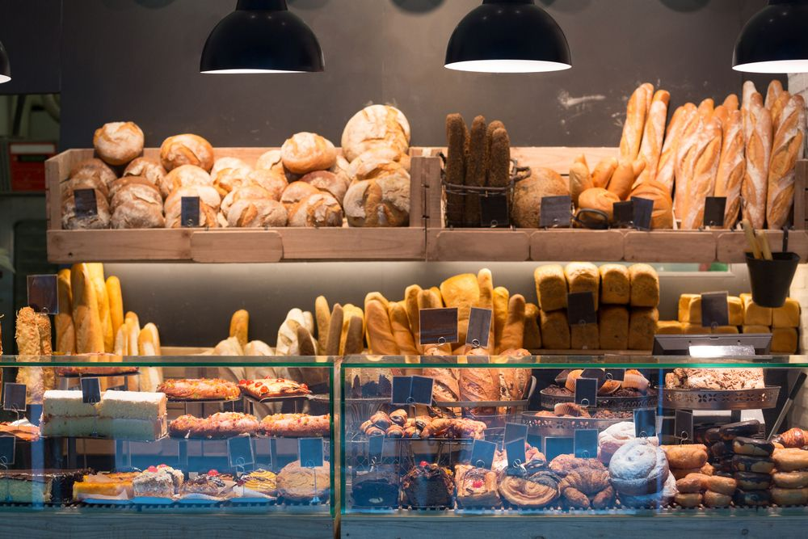
- cozy: see `cosy`. [Adj-graded] a house or room that is `cozy` is comfortable and warm. 暖和舒适的 
  [Adj-graded] if you are `cozy`, you are comfortable and warm. 感到温暖舒适的 
  [Adj-graded] you use `cozy` to describe activities that are pleasant and friendly, and involve people who know each other well. 愉快的;友好的;亲切的 
  [N] a padded cloth covering to keep a teapot warm. (茶壶的)保温罩,茶壶套 (tea cozy) 
  `cozy up to`: 讨好,奉承,巴结
- toasty: [Adj-graded] if something is `toasty`, it is comfortably warm. 暖烘烘的;温暖舒适的 [informal] 
  [Adj.] tasting or smelling like toast. 有烤面包味的 
  [N] a toasted sandwich. 烤三明治🥪 [informal]
- papaya: [N-Count] a `papaya` is a fruit with a green skin, sweet yellow flesh, and small black seeds. Papayas grow on trees in hot countries. 番木瓜;木瓜 
  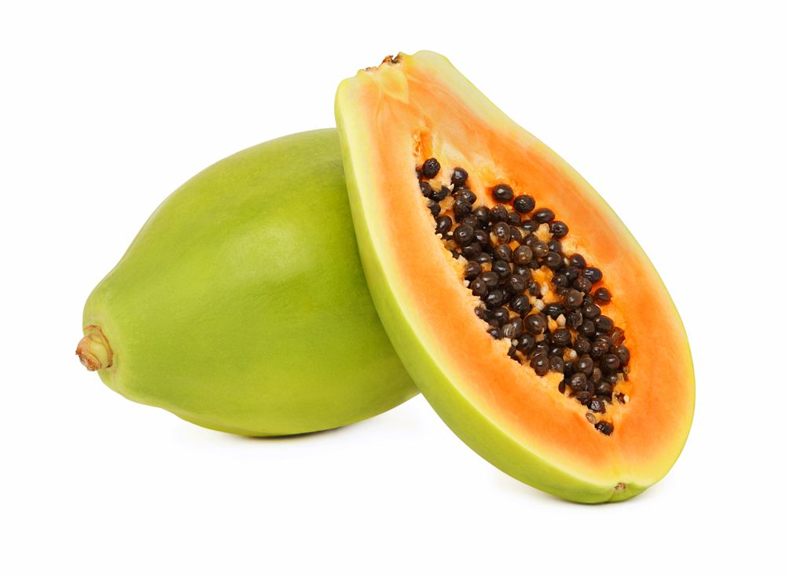
- helmet: [N-Count] a `helmet` is a hat made of a strong material which you wear to protect your head. 头盔;防护帽
- mingle: [Verb] if things such as sounds, smells, or feelings `mingle`, they become mixed together but are usually still recognizable. (声音、气味等)混合,混杂;(感情)交织,交错 
 [Verb] at a party, if you `mingle with` the other people there, you move around and talk to them. 应酬;交际 
  (Mingle) 明格尔 (人名)
- purse: [N-Count] a `purse` is a very small bag that people, especially women, keep their money in. (尤指女式🚺)钱包👛 [British] 
 [N-Count] a `purse` is a small bag that women carry. 女用小包;坤包 [US] 
 in BRIT, use `bag`, `handbag`. 
 [N-Sing] `purse` is used to refer to the total amount of money that a country, family, or group has. 资金;财力;财源 
 [Verb] if you `purse` your `lips`, you move them into a small, rounded shape, usually because you disapprove of something or when you are thinking. 缩拢,皱起,撅起(嘴唇👄) 
 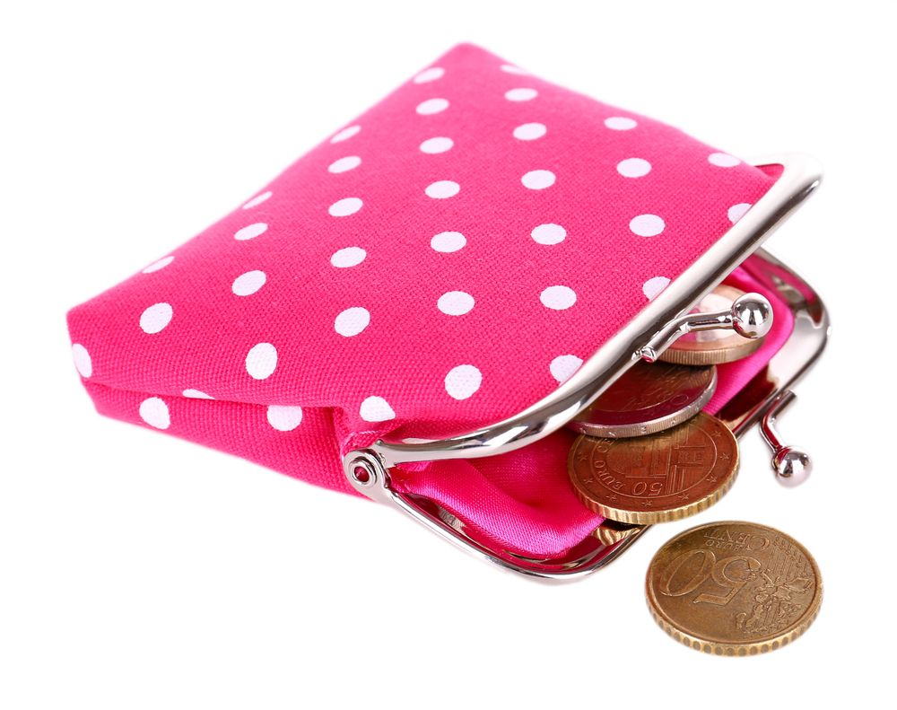
- widow: [N-Count] a `widow` is a woman whose husband has died and who has not married again. 寡妇;遗孀
- curse: [Verb] if you `curse`, you use rude or offensive language, usually because you are angry about something. 诅咒;咒骂 [written] 
 [Verb] if you `curse` someone, you say insulting things to them because you are angry with them. 咒骂;诅咒;辱骂 
 [Verb] if you `curse` something, you complain angrily about it, especially using rude language. (尤指用粗话)抱怨,发牢骚;咒骂 
 [N-Count] if you say that there is a `curse on` someone, you mean that there seems to be a supernatural power causing unpleasant things to happen to them. 诅咒;咒语 
 [N-Count] you can refer to something that causes a great deal of trouble or harm as a `curse`. 祸根;祸端;祸水 [usually singular]
- summon: [Verb] if you `summon` someone, you order them to come to you. 召唤;传唤;召见 [formal] 
 [Verb] if you `summon` a quality, you make a great effort to have it. for example, if you `summon` the courage or strength to do something, you make a great effort to be brave or strong, so that you will be able to do it. 鼓起(勇气);振作;使出(力气) 
 [Phrase] if something `summons up` a memory or thought, it causes it to come to your mind. 唤起;使想起 [literary] 
 summoner: [N-Count] 召唤者,传唤者;法院传票送达员;召唤师 (游戏职业名)
- grid: [N-Count] a `grid` is something which is in a pattern of straight lines that cross over each other, forming squares. on maps the grid is used to help you find a particular thing or place. 网格; (地图上的)坐标方格 
 [N-Count] a `grid` is a network of wires and cables by which sources of power, such as electricity, are distributed throughout a country or area. (输送电力等的)系统网络 
 [N-Count] `the grid` or `the starting grid` is the starting line on a car-racing track. 赛车起跑线
- forecast: [N-Count] a `forecast` is a statement of what is expected to happen in the future, especially in relation to a particular event or situation. 预报;预测 
 [Verb] if you `forecast` future events, you say what you think is going to happen in the future. 预测;预言
- drumstick: [N-Count] a `drumstick` is the lower part of the leg of a bird such as a chicken which is cooked and eaten. 下段鸡腿肉,琵琶腿 [usually plural] 
 [N-Count] `drumsticks` are sticks used for beating a drum. 鼓槌
- funnel: [N-Count] a `funnel` is an object with a wide, circular top and a narrow short tube at the bottom. funnels are used to pour liquids into containers which have a small opening, for example bottles. 漏斗 
 [N-Count] a `funnel` is a metal chimney on a ship or railway engine powered by steam. (蒸汽轮船或机车的)烟囱 
 [N-Count] you can describe as a `funnel` something that is narrow, or narrow at one end, through which a substance flows and is directed. 漏斗状物 
 [Verb] if something `funnels` somewhere or `is funneled` there, it is directed through a narrow space. (使)通过狭窄空间 
 [Verb] if you `funnel` money, goods, or information from one place or group to another, you cause it to be sent there as it becomes available. 输送,传送(金钱💰、货物📦或信息)
- breast: [N-Count] a woman's `breasts` are the two soft, round parts on her chest that can produce milk to feed a baby. (妇女的)乳房 [oft poss Noun] 
 [N-Count] a person's `breast` is the upper part of his or her chest. 胸;胸部;胸膛 [literary] 
 [N-Count] the `breast` is often considered to be the part of your body where your emotions are. 胸怀;内心 [literary, usually with poss] 
 [N-Count] a bird's `breast` is the front part of its body. (鸟类的)胸脯 
 [N-Sing] the `breast` of a shirt, jacket, or coat is the part which covers the top part of the chest. (衬衫👕、夹克或外套的)胸部 
 [N-Var] you can refer to piece of meat that is cut from the front of a bird or lamb as `breast`. (禽鸟或羊的)胸脯肉 
 [Phrase] if you say that someone `beats` their `breast`, you are emphasizing that they are very angry or upset about something, or that they are pretending to be very angry or upset about it. 捶胸(表示气愤或悲伤) [Verb inflects, emphasis] 
 [Phrase] if you `make a clean breast of` something, you tell someone the truth about yourself or about something wrong that you have done. 坦白;如实承认 [Verb inflects]
- cinnamon: [N-Uncounted] `cinnamon` is a sweet spice used for flavoring food. 桂皮;肉桂 
  (Cinnamon) 辛纳蒙 (人名) 
 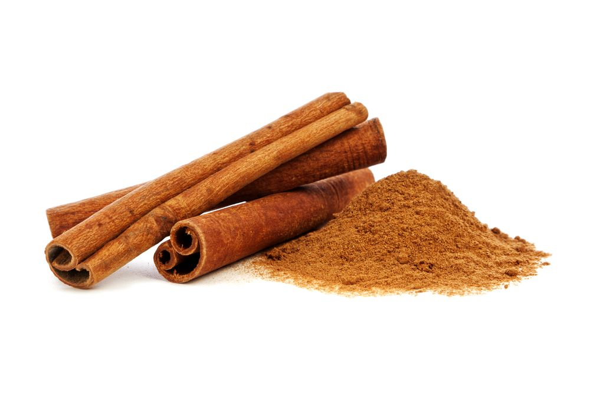
- bun: [N-Count] Buns are small bread rolls. they are sometimes sweet and may contain dried fruit or spices. 小圆面包 
 [N-Count] `buns` are small sweet cakes. they often have icing on the top. (表面覆有糖霜的)小蛋糕 [British] 
 [N-Count] if a woman has her hair in a `bun`, she has fastened it tightly on top of her head or at the back of her head in the shape of a ball. 圆发髻 
 [N-Count] your `buns` are your buttocks. 屁股 [mainly US, informal] (usually plural) 
 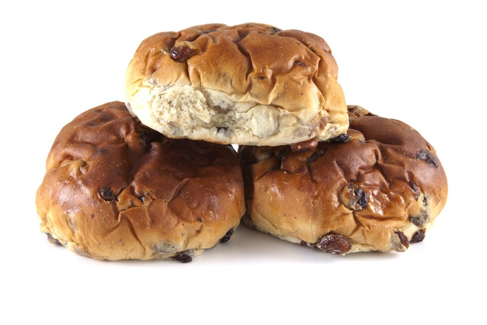
- cucumber: [N-Var] a `cucumber` is a long thin vegetable with a hard green skin and wet transparent flesh. it is eaten raw in salads. 黄瓜🥒 
 [Phrase] if you say that someone is `as cool as a cucumber`, you are emphasizing that they are very calm and relaxed, especially when you would not expect them to be. (尤指意料之外地)非常冷静,泰然自若 [emphasis] 
 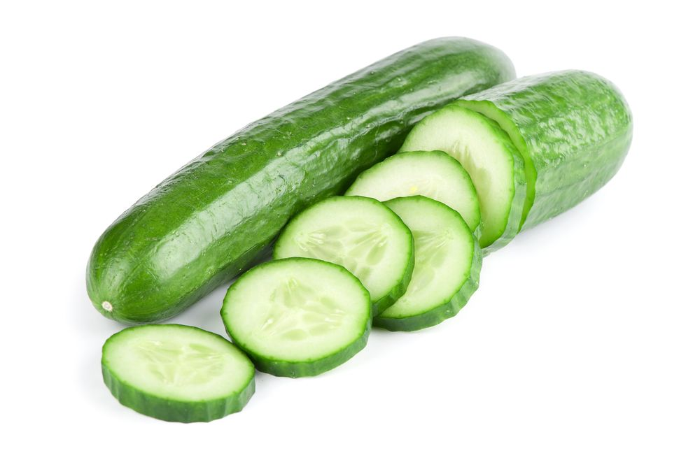
- French fry: cook by immersing in fat. (法式)薯条🍟
- dope: [N-Uncounted] `dope` is a drug, usually an illegal drug such as marijuana or cocaine. 麻醉剂;毒品(如大麻、可卡因) [informal] 
 [Verb] if someone `dopes` a person or animal or `dopes` their food, they put drugs into their food or force them to take drugs. 给...服麻醉剂(或毒品);在...中掺麻醉剂(或毒品) [also V n with n] 
 [N-Count] if someone calls a person a `dope`, they think that the person is stupid. 笨蛋;呆子;蠢货 [informal, disapproval] 
 [N-Uncounted] `dope` is information which you have been given illegally or secretly. 情报;密报 [informal]
- Nobel: [N] Swedish chemist remembered for his invention of dynamite and for the bequest that created the Nobel Prizes (1833-1896) 诺贝尔 (瑞典🇸🇪化学家及发明家,发明炸药,并以遗产创设诺贝尔奖)
- haram: [N] `Haram` is an Arabic term meaning "forbidden", often in reference to an act forbidden in Islam. anything that is forbidden by Islamic law. 伊斯兰法律所禁之事 
 [N] (伊斯兰教徒)女眷居住的内室,闺房;(伊斯兰教徒的)女眷,共配一雄的一群雌性动物
- dude: [N-Count] a `dude` is a man. 男人 [US, informal]
- durian: [N] a southeastern Asian bombacaceous tree, having very large oval fruits with a hard spiny rind containing seeds surrounded by edible evil-smelling. 榴莲;榴莲树 (=durian tree) 
 huge fruit native to southeastern Asia `smelling like Hell and tasting like Heaven`; seeds are roasted and eaten like nuts
- garlicky: [Adj-graded] `something` that is `garlicky` tastes or smells of garlic. 有大蒜味的 [usually Adj. n] 
 [N-Uncounted] `garlic` is the small, white, round bulb of a plant that is related to the onion plant. garlic has a very strong smell and taste and is used in cooking. 蒜;大蒜🧄 
 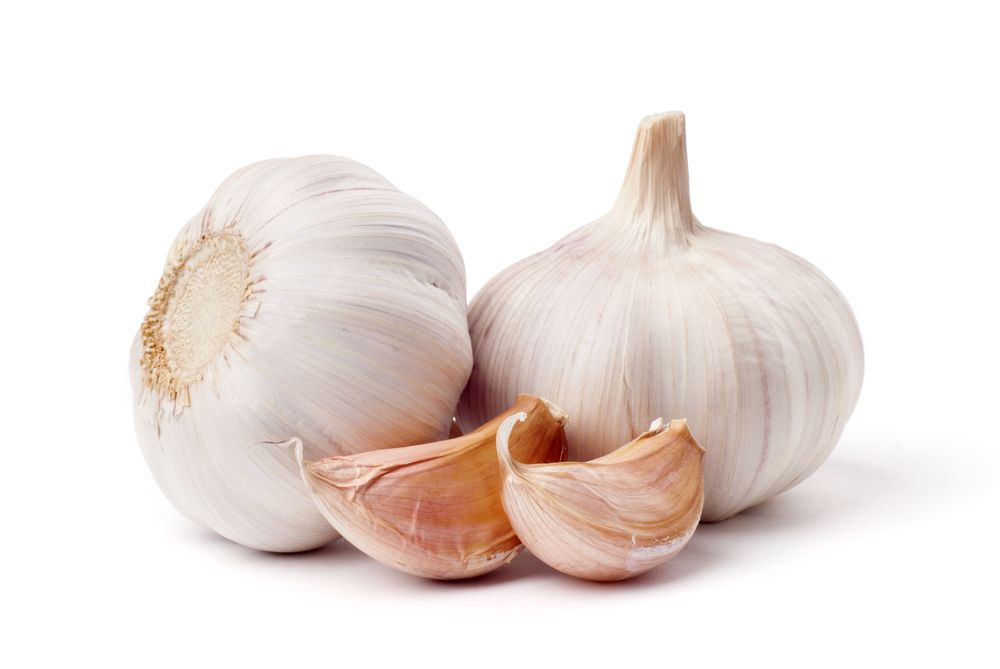
- literally: [Adverb] you can use `literally` to emphasize a statement. some careful speakers of English think that this use is incorrect. 简直(一些用词谨慎者认为此用法不正确🙅) [emphasis, Adverb before verb, Adverb adjective] 
 [Adverb] you use `literally` to emphasize that what you are saying is true, even though it seems exaggerated or surprising. 确实地;真正地;不加夸张地 [emphasis, Adverb before verb] 
 [Adverb] if a word or expression is translated `literally`, its most simple or basic meaning is translated. 照字面地;直(译)地 [Adverb with verb] 
 [Phrase] if you take something literally, you think that a word or expression is being used with its most simple or basic meaning. 照字面理解 
  literal: [Adjective] the `literal` sense of a word or phrase is its most basic sense. 字面上的;原义的 
  [Adjective] a `literal` translation is one in which you translate each word of the original work rather than giving the meaning of each expression or sentence using words that sound natural. 逐字的;直(译)的 
  [Adj-graded] you use `literal` to describe someone who uses or understands words in a plain and simple way. 言辞刻板的;听话不听音的 
  [Adjective] if you describe something as the `literal` truth or a `literal` fact, you are emphasizing that it is true. 确确实实的;完完全全的 [emphasis]
- puke: [Verb] when someone `pukes`, they vomit. 呕;吐;呕吐🤮 [informal] 
 [N-Uncounted] `puke` is the same as `vomit`. 同vomit [informal]
- fart: [Verb] if someone `farts`, air is forced out of their body through their anus. 放屁 [informal, rude] 
 [N-Count] if someone describes another person as an old `fart`, they are showing that they think the person is boring and that they do not respect the person. (老)东西;无聊的家伙 [informal, rude, disapproval] (usually adjective Noun)
- beforehand: [Adverb] if you do something `beforehand`, you do it earlier than a particular event. 预先;事先;提前 [usually Adverb after verb]
- legit: [Adj-graded] if you describe a person or thing as `legit`, you mean that they are in accordance with the law or with a particular set of rules and regulations. 奉公守法的;守规矩的;合法的 [informal] (usually verb-link Adjective)
- pumpkin: [N-Var] a `pumpkin` is a large, round, orange vegetable with a thick skin. 南瓜🎃;倭瓜 
 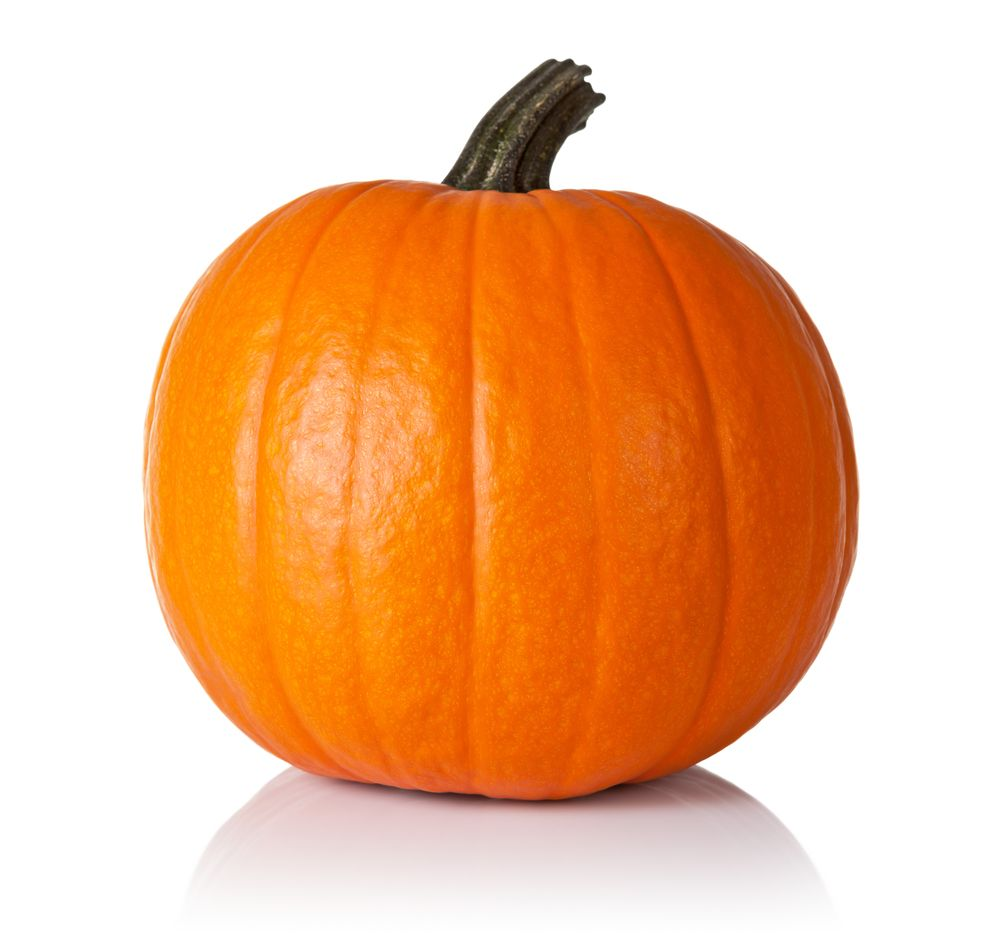
- Christmas: [N-Var] Christmas is a Christian festival when the birth of Jesus Christ is celebrated. Christmas is celebrated on the 25th of December. 圣诞节🎄(12月25日) 
 [N-Var] Christmas is the period of several days around and including Christmas Day. 圣诞节🎄期间
- nipple: [N-Count] the `nipples` on someone's body are the two small pieces of slightly hard flesh on their chest. babies suck milk from their mothers' breasts through their mothers' nipples. 乳头 
  [N-Count] a `nipple` is a piece of rubber or plastic which is fitted to the top of a baby's bottle. (橡皮或塑料)奶嘴
- boob: [N-Count] a woman's `boobs` are her breasts. (女性的)乳房,奶子 [informal, rude] (usually plural) 
  [Verb] if you `boob`, you make a mistake. 犯错误 [British, informal]
- wheel: [N-Count] the `wheels` of a vehicle are the circular objects which are fixed underneath it and which enable it to move along the ground. 轮;轮子;车轮🛞 
 [N-Count] a `wheel` is a circular object which forms a part of a machine, usually a moving part. 机轮 
 [N-Count] `the wheel` of a car or other vehicle is the circular object that is used to steer it. `the wheel` is used in expressions to talk about who is driving a vehicle. for example, if someone is `at the wheel` of a car, they are driving it. 方向盘 [usually singular] 
 [N-Plural] people sometimes refer to a car as `wheels`. 汽车🚗 [informal] 
 [Verb] if you `wheel` an object that has wheels somewhere, you push it along. 推(带轮子的物体) 
 [Verb] if something such as a group of animals or birds `wheels`, it moves in a circle. (动物、鸟禽等)转圈,旋转,盘旋 [literary] 
 [Verb] if you `wheel` around, you turn around suddenly where you are standing, often because you are surprised, shocked, or angry. (因惊讶、震惊或生气😠)突然转身 
 [N-Sing] you use `wheel` in expressions such as `the wheel of fortune` to refer to the changes that take place in life, especially when you are referring to the fact that the same situations occur more than once. (尤指多次发生相同的情形)命运之轮 [the Noun of n] 
 [N-Plural] people talk about `the wheels of` an organization or system to mean the way in which it operates. to `oil the wheels` -> see: `oil` (组织或系统的)运作方式 
 [Phrase] if you say that there are `wheels within wheels`, you mean that there are a number of different influences, reasons, and actions which together make a situation complicated and difficult to understand. (各种影响、原因和行动交织在一起的)错综复杂的情况
- spin: [Verb] if something `spins` or if you `spin` it, it turns quickly around a central point. (使)旋转 
 [Verb] when you `spin` washing, it is turned round and round quickly in a spin drier or a washing machine to get the water out. (用甩干机或洗衣机)甩干(衣服),给...脱水 
 [Verb] if your head `is spinning`, you feel unsteady or confused, for example because you are drunk, ill, or excited. (因醉酒、生病😷或兴奋🥰而)头晕😵‍💫 
 [N-Sing] if someone puts a certain `spin` on an event or situation, they interpret it and try to present it in a particular way. 带倾向性的解释(或说法) [informal] 
 [N-Uncounted] in politics, `spin` is the way in which political parties try to present everything they do in a positive way to the public and the media. (政治上的)倾向性报道 
 [N-Sing] if you go for `a spin` or take a car for `a spin`, you make a short journey in a car just to enjoy yourself. (乘车)兜风 
 [Verb] if someone `spins` a story, they give you an account of something that is untrue or only partly true. 杜撰;虚构;编造 [also Verb Noun n] 
 [Verb] when people `spin`, they make thread by twisting together pieces of a fiber such as wool or cotton using a device or machine. 纺纱;纺线 [also Verb] 
 [N-Sing] if a plane goes into `a spin`, it falls very rapidly towards the ground in a spiral movement. (飞机的)螺旋式急遽下坠,向下旋冲 
 [N-Uncounted] in a game such as tennis or cricket, if you put spin on a ball, you deliberately make it span rapidly when you hit it or throw it. (网球🎾或板球运动中球的)快速旋转,旋转运动 
 [Phrase] if you say that someone is `in a spin` or `in a flat spin`, you mean that they are confused and unable to act sensibly because of something that has happened. 感到惊慌失措😱 [British, informal]
- claim: [Verb] if you say that someone `claims that` something is true, you mean they say that it is true, but you are not sure whether they are telling the truth. 声称;断言 
 [N-Count] a `claim` is something which someone says which they cannot prove and which may be false. 声称;断言 [oft Noun that] 
 [Verb] if you say that someone `claims` responsibility or credit for something, you mean they say that they are responsible for it, but you are not sure whether they are telling the truth. 声称(负有责任或享有功劳) 
 [Verb] if you `claim` something, you try to get it because you think you have a right to it. 索取,索要(有权拥有的东西) 
 [N-Count] a `claim` is a demand for something that you think you have a right to. 主张;要求 
 [Verb] if someone `claims` a record, title, or prize, they gain or win it. 取得,获得,赢得(纪录、冠军或奖励) [journalism] 
 [N-Count] if you have a `claim on` someone or their attention, you have the right to demand things from them or to demand their attention. 权利;要求权 
 [Verb] if something or someone `claims` your attention, they need you to spend your time and effort on them. 需要,要求(花时间或精力) 
 [Verb] if you `claim` money from the government, an insurance company, or another organization, you officially apply to them for it, because you think you are entitled to it according to their rules. 索要,索取,申领(钱) 
 [Verb] if you `claim` money or other benefits from your employers, you demand them because you think you deserve or need them. (向雇主)索要,索取,讨要(钱、福利) 
 [Verb] if you say that a war, disease, or accident `claims` someone's life, you mean that they are killed in it or by it. (战争、疾病、事故)夺去(生命),导致(死亡) [formal] 
 [Phrase] someone's `claim to fame` is something quite important or interesting that they have done or that is connected with them. 成名之举;成名之作 
 [Phrase] if you `lay claim to` something you do not have, you say that it belongs to you. 声称拥有 [formal]
- debut: [N-Count] the `debut` of a performer or sports player is their first public performance, appearance, or recording. (表演者或运动员的)首次登台,初次露面;(歌手的)首次录音 [oft with poss]
- proposal: [N-Count] a `proposal` is a plan or an idea, often a formal or written one, which is suggested for people to think about and decide upon. 提议;建议;提案 [Noun to-infinitive] 
 [N-Count] a `proposal` is the act of asking someone to marry you. 求婚
- desire: [N-Count] a `desire` is a strong wish to do or have something. 渴望;热望;欲望 [oft Noun to-infinitive] 
 [Verb] if you `desire` something, you want it. 渴望;想望;想要 [formal] (no cont) 
 [N-Uncounted] `desire` for someone is a strong feeling of wanting to have sex with them. 情欲;肉欲;性欲 
 [Verb] if you `desire` someone, you want to have sex with them. 想与...发生性关系 [no cont] 
 [Phrase] `if desired` is used in instructions in written English to indicate that someone can choose to take the course of action mentioned. (用于说明性的书面语中)如果需要的话,如果愿意的话 
 [Phrase] if you say that someone or something is your `heart's desire`, you mean that you want that person or thing very much. 心里想望之人;心中渴望之物 [literary] (Ns inflect, usu poss PHR) 
 [Phrase] if you say that something `leaves` a lot `to be desired`, you mean that it is not as good as it should be. 尚有(许多)需要改进之处;有待(大幅)提高 [disapproval]
- tattoo: [N-Count] a `tattoo` is a design that is drawn on someone's skin using needles to make little holes and filling them with colored dye. 文身;刺青 
 [Verb] if someone `tattoos` you, they give you a tattoo. 给...文身;在...身上刺花纹 
 [N-Count] a military `tattoo` is a public display of exercises and music given by members of the armed forces. (军队的)表演操 [British] 
 [N-Count] if you beat a `tattoo`, you hit something quickly and repeatedly. 快速的击打;不停的敲击 [usually singular]
- peek: [Verb] if you `peek at` something or someone, you have a quick look at them, often secretly. 瞥;偷看;窥视👀 
 [N-Count] `peek` is a secret look. 一瞥 
 (Peek) 皮克 (人名)
- squish: [Verb] to crush, especially to make a soft splashing noise. 挤压,压扁,把...挤扁;咯吱咯吱地压碎; (在泥泞中)咕唧咕唧地走 
 [N-Count] the noise of soft mud being walked on. 咯吱声,咕唧声
- appetizer: [N-Count] an `appetizer` is the first course of a meal. it consists of a small amount of food. (餐前的)开胃小吃 
 in BRIT, also use `appetiser`.
- lush: [Adj-graded] `lush` fields or gardens have a lot of very healthy grass or plants. 葱郁的;葱茏的;草木茂盛的 
 [Adj-graded] if you describe a place or thing as `lush`, you mean that it is very luxurious. 豪华的;奢侈的 
 [N-Count] if you describe someone as a `lush`, you mean that they drink too much alcohol. 醉鬼;酒鬼 [informal] 
  (Lush) 勒什 (人名)
- passion fruit: [N-Var] a passion fruit is a small, round, brown fruit that is produced by certain types of tropical flower. 西番莲果;鸡蛋果;百香果 
 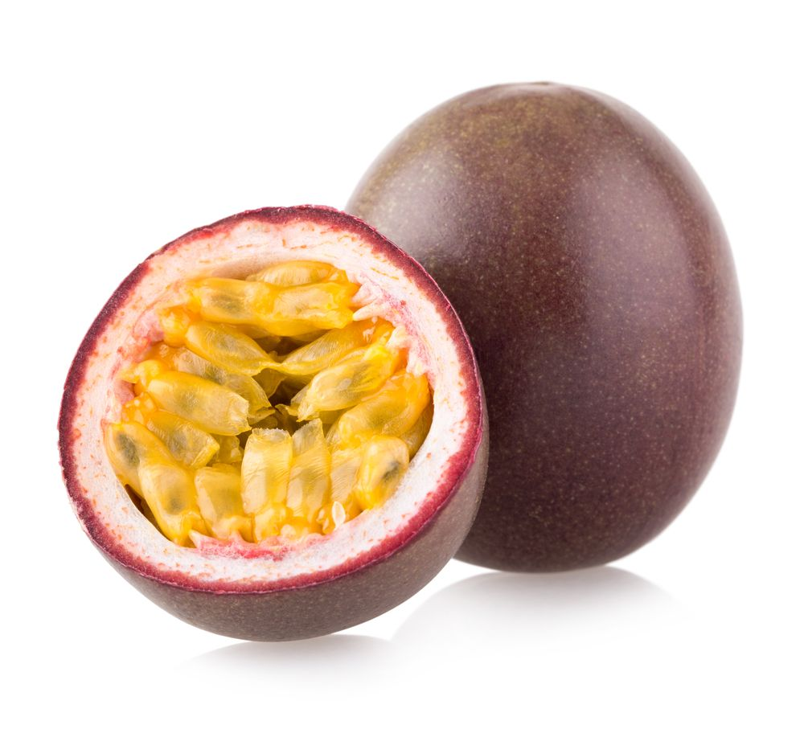
- curl: [N-Count] if you have `curls`, your hair is in the form of tight curves and spirals. 鬈发;卷发 
 [N-Uncounted] if your hair has `curl`, it is full of curls. 卷;弯曲 
 [Verb] if your hair `curls` or if you `curl` it, it is full of curls. 卷; (使)卷曲; (使)鬈曲 
 [N-Count] a `curl of` something is a piece or quantity of it that is curved or spiral in shape. 卷曲物;螺旋状物 
 [Verb] if your toes, fingers, or other parts of your body `curl`, or if you `curl` them, they form a curved or round shape. (使)(脚趾、手指等)蜷曲;(使)蜷缩 
 [Verb] if something `curls` somewhere, or if you `curl` it there, it moves there in a spiral or curve. (使)呈螺旋(或卷曲)状移动;(使)旋绕 
 [Verb] if a person or animal `curls into` a ball, they move into a position in which their body makes a rounded shape. 蜷缩 
 [Verb] when a leaf, a piece of paper, or another flat object `curls`, its edges bend towards the center. (叶子、纸等)卷边 
 [Verb] if you `curl` your lip, you raise your upper lip slightly at one side, as a way of showing anger or contempt. 撇(嘴) 
 (Curl) 柯尔 (人名)
- blanket: [N-Count] a `blanket` is a large square or rectangular piece of thick cloth, especially one which you put on a bed to keep you warm. 毯子;毛毯 
 [N-Count] a `blanket of` something such as snow is a continuous layer of it which hides what is below or beyond it. 覆盖层 [usually singular] 
 [N-Sing] you can refer to something such as an unpleasant emotion or an undesirable quality that seems to affect every aspect of a particular situation as a `blanket of` that emotion or quality. (不好的情感、性质等的)弥漫,充斥 [literary] (Noun of n) 
 [Verb] if something such as snow blankets an area, it covers it. 覆盖;遮盖;盖住 
 [Adj-graded] you use `blanket` to describe something when you want to emphasize that it affects or refers to every person or thing in a group, without any exceptions. 通用的;全面的;无一例外的 [emphasis]
- massage: [N-Var] `massage` is the action of squeezing and rubbing someone's body, as a way of making them relax or reducing their pain. 按摩;推拿 
 [Verb] if you `massage` someone or a part of their body, you squeeze and rub their body, in order to make them relax or reduce their pain. 为...按摩;给...推拿 
 [Verb] if you say that someone `massages` statistics, figures, or evidence, you are criticizing them for changing or presenting the facts in a way that misleads people. 修改,改动,窜改(数据或证据以掩人耳目) [disapproval]
- Bangkok: [N] the capital and largest city and chief port of Thailand; a leading city in southeastern Asia; noted for Buddhist architecture. 曼谷(泰国首都,泰国最大城市和主要港口)
- mouse pad: [N-Count] a `mouse pad` is the same as a `mouse mat`. 同 mouse mat [mainly US] 
 [N-Count] a `mouse mat` is a flat piece of plastic or some other material that you rest the mouse on while using a computer. 鼠标垫 [British]
- slurp: [Verb] if you `slurp` a liquid, you drink it noisily. 大声地啜;出声地喝 
 [N-Count] a `slurp` is a noise that you make with your mouth when you drink noisily, or a mouthful of liquid that you drink noisily. (喝东西时发出的)咕嘟声
- bunny: [N-Count] a `bunny` or a `bunny rabbit` is a child's word for a rabbit. (儿语)兔子🐰 [informal] 
 (Bunny) 邦尼 (人名)
- rub: [Verb] if you `rub` a part of your body, you move your hand or fingers backwards and forwards over it while pressing firmly. 揉;按摩;搓 
 [Verb] if you `rub against` a surface or `rub` a part of your body `against` a surface, you move it backwards and forwards while pressing it against the surface. 摩擦;蹭 
 [Verb] if you `rub` an object or a surface, you move a cloth backward and forward over it in order to clean or dry it. (用布)擦干,擦净,擦拭 
 [Verb] if you `rub` a substance `into` a surface or `rub` something such as dirt `from` a surface, you spread it over the surface or remove it from the surface using your hand or something such as a cloth. 涂抹;搽;擦去 
 [Verb] if you `rub` two things `together` or if they `rub together`, they move backwards and forwards, pressing against each other. 相互摩擦;揉搓 
 [Verb] if something you are wearing or holding `rubs`, it makes you sore because it keeps moving backwards and forwards against your skin. 擦伤;磨痛 [also Verb N] 
 [N-Sing] `rub` is used in expressions such as `there's the rub` and `the rub is` when you are mentioning a difficulty that makes something hard or impossible to achieve. 困难;难处;障碍 [formal] 
 [N-Count] a massage can be referred to as a `rub`. 按摩 [usually singular] 
 [N-Count] a `rub` is a substance that you massage into your skin. 按摩膏;面膜 [usually with supplement] 
 [Phrase] if you `rub shoulders with` famous people, you meet them and talk to them. you can also say that you `rub elbows with` someone, especially in American English. (尤用于美国英语)和(名人)接触,和(名人)交往 
 [Phrase] if you `rub` someone `up the wrong way` in British English, or `rub` someone `the wrong way` in American English, you offend or annoy them without intending to. 无意中冒犯;无意中惹恼 [informal]
- tier: [N-Count] a `tier` is a row or layer of something that has other layers above or below it. 一排;一行;一列 
 [N-Count] a `tier` is a level in an organization or system. (组织或系统的)层,级 
 [Comb in Adjective] tier is also a combining form. (用于构成合成形容词) ...排的; ...层的 
 [Comb in Adjective] tier is also a combining form. (用于构成合成形容词) ...级的 
 [Verb] to be or arrange in tiers. 使层叠; 按层排列 
 (Tier) 蒂尔 (人名)
- weary: [Adjective-Graded] if you are `weary`, you are very tired. 疲倦的;疲劳的 
 [Adjective-Graded] if you are `weary of` something, you have become tired of it and have lost your enthusiasm for it. 不再感兴趣的;感到厌烦的 
 [Verb] if you `weary` of something or it `wearies` you, you become tired of it and lose your enthusiasm for it. (使)厌倦; (使)失去热情 [formal] 
 world-weary: 厌世的;讨厌人世的
- nail: [N-Count] a `nail` is a thin piece of metal with one pointed end and one flat end. you hit the flat end with a hammer in order to push the nail into something such as a wall. 钉子 
 [Verb] if you `nail` something somewhere, you fix it there using one or more nails. (用钉子)钉住,钉牢 
 [N-Count] your `nails` are the thin hard parts that grow at the ends of your fingers and toes. 指甲;趾甲 
 [Verb] to `nail` someone means to catch them and prove that they have been breaking the law. 抓住;逮住;证明...有罪 [informal] 
 [Phrase] if you say that someone is `as hard as nails`, you mean that they are extremely tough and aggressive, either physically or in their attitude towards other people or other situations. 冷酷无情的;铁石心肠的;强硬好斗的 
 [Phrase] if you say that someone `has hit the nail on the head`, you think they are exactly right about something. 正中要害;说得中肯 
 (Nail) 纳伊 (人名)
- necklace: [N-Count] a `necklace` is a piece of jewelry such as a chain or a string of beads which someone, usually a woman, wears round their neck. 项圈;项链 
 [Verb] to `necklace` someone means to kill them by putting a tire soaked in petrol around their neck and then setting fire to it. (主要指南非)给...戴火项链(指将淋了汽油的轮胎套在某人脖子上并点燃的私刑) [also Verb N]
- cow: [N-Count] a `cow` is a large female animal that is kept on farms for its milk. people sometimes refer to male and female animals of this species as `cows`. 母牛;奶牛🐄; (有时统称)牛🐮 
 [N-Count] some female animals, including elephants and whales, are called `cows`. 雌性动物(如雌象、雌鲸等) 
 [N-Count] if someone describes a woman as a `cow`, they dislike her and think that she is unpleasant or stupid. 婆娘;娘儿们 [informal, offensive, disapproval] 
 [Verb] if someone `is cowed`, they are made afraid, or made to behave in a particular way because they have been frightened or badly treated. 恐吓;威胁;把...吓住 [formal] 
 [Phrase] if you say that someone can do something `until the cows come home`, but it will have no effect, you are emphasizing that it will have no effect even if they do it for a very long time. 很长时间;长期 [informal, emphasis] 
 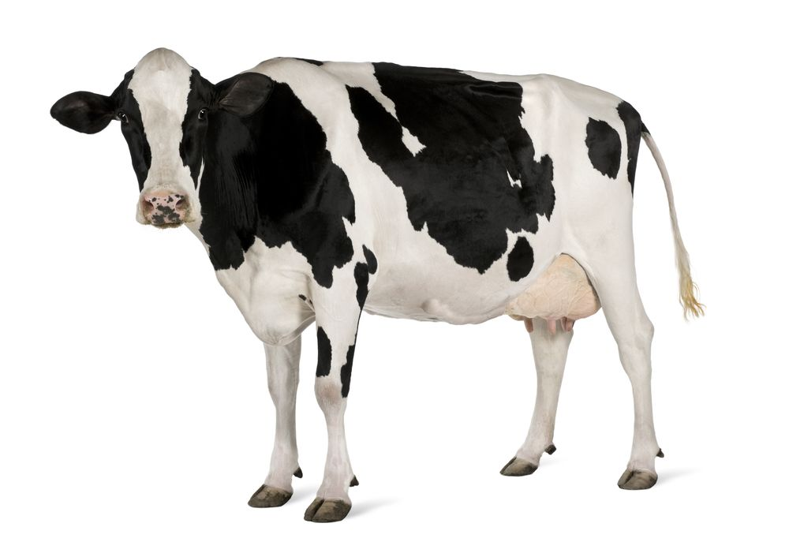
- succubus: [N] a female demon believed to have sexual intercourse with sleeping men. 一种与睡梦中的男子性交的女妖 (also called succuba);魅魔
- tire: [N-Count] a `tire` is a thick piece of rubber which is fitted onto the wheels of vehicles such as cars, buses, and bicycles. 轮胎;车胎🛞 
 in BRIT, use `tyre`.
- sloppy: [Adjective-Graded] if you describe someone's work or activities as `sloppy`, you mean they have been done in a careless and lazy way. 马虎的;敷衍的;草率的 [disapproval] 
 [Adjective-Graded] if you describe someone or something as `sloppy`, you mean that they are sentimental and romantic. 伤感浪漫的;无病呻吟的
- tide: [N-Count] `the tide` is the regular change in the level of the sea on the shore. 潮;潮水;潮汐🌊 
 [N-Count] a `tide` is a current in the sea that is caused by the regular and continuous movement of large areas of water towards and away from the shore. (不断冲刷海岸的)潮水,潮汐🌊 
 [N-Sing] the `tide of` opinion, for example, is what the majority of people think at a particular time. (观点等的)潮流,趋势 
 [N-Sing] people sometimes refer to events or forces that are difficult or impossible to control as `the tide of` history, for example. (无法抗拒的)潮流,浪潮 
 [N-Sing] you can talk about a `tide of` something, especially something which is unpleasant, when there is a large and increasing amount of it. (尤指不好的)浪潮,势头
- slut: [N-Count] people sometimes refer to a woman as a `slut` when they consider her to be very immoral in her sexual behavior. 荡妇;娼妓;婊子;母狗 [offensive, disapproval]
- erotic: [Adjective-Graded] if you describe something as `erotic`, you mean that it involves sexual feelings or arouses sexual desire. 性爱的; (引起)性欲的;撩人的 
 [Adjective] `erotic` art shows naked people or sexual acts, and is intended to produce feelings of sexual pleasure. (艺术)色情的,情爱的 
 [N] an erotic person. 好色之徒
- blow: [Verb] when a wind or breeze `blows`, the air moves. (风)吹,刮 
 [Verb] if the wind `blows` something somewhere or if it `blows` there, the wind moves it there. (风)把...吹到;吹到,吹向 [also Verb N preposition] 
 [Verb] if you `blow`, you send out a stream of air from your mouth. 吹气;呼气 
 [Verb] if you `blow` something somewhere, you move it by sending out a stream of air from your mouth. (用嘴)吹,把...吹到 [also Verb N preposition] 
 [Verb] if you `blow` bubbles or smoke rings, you make them by blowing air out of your mouth through liquid or smoke. 吹,吐(泡泡🫧、烟圈等) 
 [V-T/V-I] when a whistle or horn `blows` or someone `blows` it, they make a sound by blowing into it. 吹奏;吹响;鸣响 
 [Verb] when you `blow` your nose, you force air out of it through your nostrils in order to clear it. 擤(鼻子) 
 [Verb] to `blow` something `out`, `off`, or `away` means to remove or destroy it violently with an explosion. 炸飞;炸毁 
 [Verb] if you say that something `blows` an event, situation, or argument into a particular extreme state, especially an uncertain or unpleasant state, you mean that it causes it to be in that state. 导致;致使 
 [Verb] if you `blow` a large amount of money, you spend it quickly on luxuries. 挥霍;乱花 [informal] 
 [Verb] if you `blow` a chance or attempt to do something, you make a mistake which wastes the chance or causes the attempt to fail. 失去,断送(机会);搞砸(努力) [informal] 
 [V-T/V-I] if a fuse `blows` or if something `blows` it, the fuse melts because too much electricity has been sent through it, and the electrical current is cut off. (保险丝)烧断;使(保险丝)熔断 [also Verb N] 
 [V-T/V-I] if you `blow` a tire or if it `blows`, a hole suddenly appears in it and all the air comes out of it. (轮胎)爆裂;使(轮胎)爆裂 
 [Phrase] if you `blow` your `own trumpet` or `blow` your `own horn`, you tell people that you are very clever or successful. 自我炫耀;自吹自擂 [Verb and Noun inflect] 
 [N-Count] if someone receives a `blow`, they are hit with a fist or weapon. 重击;猛击 
 [N-Count] if something that happens is a `blow to` someone or something, it is very upsetting, disappointing, or damaging to them. 打击;挫折 
 [Phrase] if two people or groups `come to blows`, they start fighting. 激烈争吵;动武;打架 
 [Phrase] something that `softens the blow` or `cushions the blow` makes an unpleasant change or piece of news easier to accept. 减轻,缓和,缓解(打击等) [Verb inflects] 
 [Phrase] if you `strike a blow for` a particular cause or principle, you do something that supports it or makes it more likely to succeed. 支持;拥护;为...而战 [Verb inflects, Phrase N]
- quota: [N-Count] a `quota` is the limited number or quantity of something which is officially allowed. 定量;定额;配额 
 [N-Count] a `quota` is a fixed maximum or minimum proportion of people from a particular group who are allowed to do something, such as come and live in a country or work for the government. (给予某团体的)限额,配额 [also + of] 
 [N-Count] someone's `quota of` something is their expected or deserved share of it. 配额;份额;指标
- brew: [Verb] if you `brew` tea or coffee, you make it by pouring hot water over tea leaves or ground coffee. 沏(茶🍵);冲(咖啡☕️) 
 [N-Count] a `brew` is a particular kind of tea or coffee. it can also be a particular pot of tea or coffee. (某种)茶,咖啡;一壶茶(或咖啡) 
 [Verb] if a person or company `brews` beer, they make it. 酿(啤酒) 
 [N-Count] a `brew` is a particular kind of beer or beer that is produced in a particular place at a particular time. (某种或某地某一时间生产的)啤酒🍺 [usually with supplement] 
 [Verb] if a storm `is brewing`, large clouds are beginning to form and the sky is becoming dark because there is going to be a storm. (风暴)酝酿 [usually cont] 
 [Verb] if an unpleasant or difficult situation `is brewing`, it is starting to develop. (困境或危机)酝酿,形成 [usually cont] 
 [N-Count] a `brew of` several things is a mixture of those things. 混合物 [usually singular] 
 (Brew) 布鲁 (人名)
- newbie: [N-Count] a `newbie` is someone who is new to an activity, especially in computing or on the internet. (尤指使用电脑或网络的)新人,新手,菜鸟
- popcorn: [N-Uncounted] `popcorn` is a snack which consists of grains of maize or corn that have been heated until they have burst and become large and light. it can be eaten with salt or sometimes sugar. 爆玉米花 
 popcorn chicken: 劲爆鸡米花;盐酥鸡 
 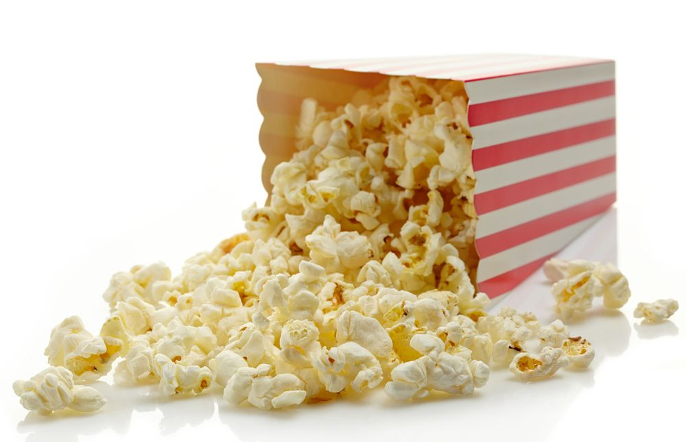
- stare: [Verb] if you `stare at` someone or something, you look at them for a long time. 凝视;盯着看 
 [Phrase] if a situation or the answer to a problem `is staring` you `in the face`, it is very obvious, although you may not be immediately aware of it. (局势、解决办法等)非常明显的,明摆在眼前 [informal]
- tequila: [N-Mass] `tequila` is a strong alcoholic drink made in Mexico from a type of cactus plant. 龙舌兰酒,特奎拉酒(一种墨西哥产的烈性酒) 
 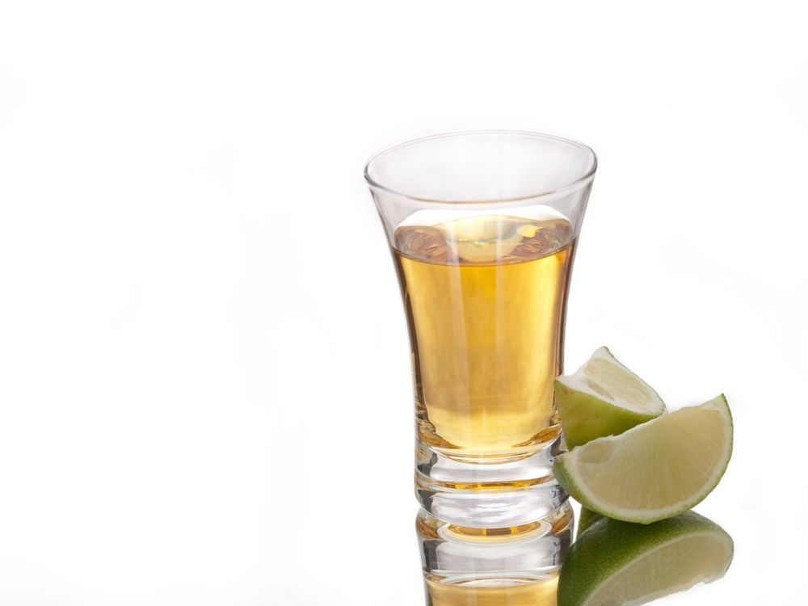
- wiggle: [V-T/V-I] if you `wiggle` something or if it `wiggles`, it moves up and down or from side to side in small quick movements. (使)扭动;(使)摆动 
 [N-Count] `wiggle` is also a noun. 摆动; 扭动
- outfit: [N-Count] an `outfit` is a set of clothes. 全套服装 
 [N-Count] you can refer to an organization as an `outfit`. 机构;组织 
 [Verb] to `outfit` someone or something means to provide them with equipment for a particular purpose. 装备;配备;供给 [mainly US] (also Verb N + as)
- outline: [Verb] if you `outline` an idea or a plan, you explain it in a general way. 概述;概括 
 [N-Count] an `outline` is a general explanation or description of something. 概要;梗概 [oft in Noun] 
 [V-Passive] you say that an object `is outlined` when you can see its general shape because there is light behind it. (因背后的光线)显示...的轮廓(或外形) 
 [N-Count] the `outline` of something is its general shape, especially when it cannot be clearly seen. (尤指模糊的)轮廓,外形
- helmet: [N-Count] a `helmet` is a hat made of a strong material which you wear to protect your head. 头盔🪖;防护帽
- squid: [N-Count] a `squid` is a sea creature with a long soft body and many soft arms called tentacles. 枪乌贼🦑;鱿鱼 
 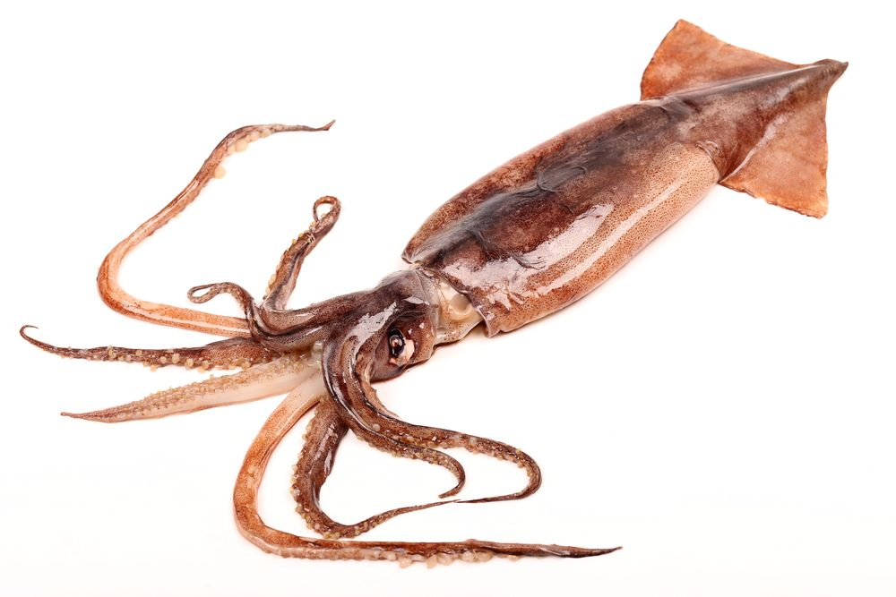
- witch: [N-Count] in fairy stories, a `witch` is a woman, usually an old woman, who has evil magic powers. witches often wear a pointed black hat, and have a pet black cat. (童话故事中的)女巫,巫婆 
 [N-Count] a `witch` is a man or woman who claims to have magic powers and to be able to use them for good or bad purposes. 巫师
- ego: [N-Var] someone's `ego` is their sense of their own worth. for example, if someone has a large `ego`, they think they are very important and valuable. 自我;自我评价;自尊
- enigmatic: [Adjective-Graded] someone or something that is `enigmatic` is mysterious and difficult to understand. 神秘的;谜一般的;费解的 
 enigmatic figure: 不可捉摸的人 enigmatic encounter: 谜一般的遭遇;神秘际遇
- mafia: [N-Count-Coll] `the Mafia` is a criminal organization that makes money illegally, especially by threatening people and dealing in drugs. 黑手党 
 [N-Count] you can use `mafia` to refer to an organized group of people who you disapprove of because they use unfair or illegal means in order to get what they want. 黑帮;势力集团;秘密犯罪团伙 
 Mafia II: 黑手党2 Mafia III: 黑手党;四海兄弟 Mafia-style organizations: 黑社会;黑社会形态
- slay: [Verb] if someone `slays` an animal, they kill it in a violent way. 残杀;屠杀;杀戮 [formal] 
 [V-Passive] if someone `has been slain`, they have been murdered. 谋杀 [mainly US]
- streak: [N-Count] a `streak` is a long stripe or mark on a surface which contrasts with the surface because it is a different color. 条纹;条痕 
 [Verb] if something `streaks` a surface, it makes long stripes or marks on the surface. 在...上留下条纹(或条痕);使布满条纹(或条痕) 
 [N-Count] if someone has a `streak` of a particular type of behavior, they sometimes behave in that way. (尤指不好的)性格特征;特点 [usually singular] 
 [Verb] if something or someone `streaks` somewhere, they move there very quickly. 飞奔;疾驰 
 [Verb] to run naked through a crowd of people in a public place in order to shock or amuse them. 裸奔 [informal] 
 [N-Count] a winning `streak` or a lucky `streak` is a continuous series of successes, for example in gambling or sport. a losing `streak` or an unlucky `streak` is a series of failures or losses. (赌博或体育比赛等中的)运气,手气 [adjective Noun] 
 winning streak: 连胜场数;连胜 losing streak: 连败场数;连败;连败纪录 four-game losing streak: 四连败
- badge: [N-Count] a `badge` is a piece of metal or cloth which you wear to show that you belong to an organization or support a cause. American English usually uses `button` to refer to a small round metal badge. 徽章,证章(美国英语通常用button指金属小圆徽章) 
 [N-Sing] any feature which is regarded as a sign of a particular quality can be referred to as a `badge`. 标志;标记;象征 [usually Noun of N]
- leaderboard: [N-Sing] `the leaderboard` is a board that shows the names and positions of the leading competitors in a competition, especially a golf tournament. (尤指高尔夫锦标赛的)选手积分榜
- tote: [N-Sing] `the Tote` is a system of betting money on horses in races. (赛马的)赌金计算系统 [British] 
 [Verb] to `tote` something, especially a gun, means to carry it with you in such a way that people can see it. (可见地)携带;(尤指)佩(枪) [journalism] 
 tote bag: 托特包;大型女用手提包👜;大手提袋
- compose: [Verb] the things that something `is composed of` are its parts or members. the separate things that `compose` something are the parts or members that form it. 组成;构成 
 [Verb] when someone `composes` a piece of music, they write it. 谱写(乐曲);作(曲) 
 [Verb] if you `compose` something such as a letter, poem, or speech, you write it, often using a lot of concentration or skill. 创作,写(信、诗或演讲稿) [formal] 
 [Verb] if you `compose` a picture or image, you arrange it in an attractive and artistic way. 为(照片、图像)构图 [technical] 
 [Verb] if you `compose yourself` or if you `compose` your features, you succeed in becoming calm after you have been angry, excited, or upset. 使(自己)平静(或镇定);使(表情)镇静下来 
 compose mail: 撰写邮件 compose note: 撰写正文
- gossip: [N-Uncounted] `gossip` is informal conversation, often about other people's private affairs. 流言蜚语;小道消息;闲话 
 [Verb] if you `gossip with` someone, you talk informally, especially about other people or local events. you can also say that two people gossip. 闲聊;说长道短;说三道四 
 [N-Count] if you describe someone as a `gossip`, you mean that they enjoy talking informally to people about the private affairs of others. 爱说长道短的人;爱说三道四的人 [disapproval] 
 gossip girl: 绯闻女孩;花边教主 gossip column: 闲话栏;漫谈随笔;闲话专栏;八卦专栏
- drugstore: [N-Count] in the United States, a `drugstore` is a shop where drugs and medicines are sold or given out, and where you can buy cosmetics, some household goods, and also drinks and snacks. (美国🇺🇸兼售化妆品💄、家居用品🧹、饮料🥤、小吃等的)药店,药房
- impersonate: [Verb] if someone `impersonates` a person, they pretend to be that person, either to deceive people or to make people laugh. 假冒(尤指为欺骗);模仿(尤指为逗乐或表演)
- accuse: [Verb] if you `accuse` someone `of` doing something wrong or dishonest, you say or tell them that you believe that they did it. 指责;责难 [also Verb N] 
 [Verb] if you `are accused of` a crime, a witness or someone in authority states or claims that you did it, and you may be formally charged with it and put on trial. 指控;控告 [also Verb N] 
 [Phrase] if someone `stands accused of` something, they have been accused of it. 遭指责;受指控
- defense: [N-Uncounted] `defense` is action that is taken to protect someone or something against attack. 防御;保卫;保护 
 [N-Uncounted] `defense` is the organization of a country's armies and weapons, and their use to protect the country or its interests. 国防;军事防御 
 [N-Plural] the `defenses` of a country or region are all its armed forces and weapons. (国家或地区的)防御力量 
 [N-Count] a `defense` is something that people or animals can use or do to protect themselves. 防御物;防卫手段 
 [N-Count] a `defense` is something that you say or write which supports ideas or actions that have been criticized or questioned. 辩护;辩解 
 [N-Count] in a court of law, an accused person's `defense` is the process of presenting evidence in their favor. (法庭上被告的)辩护,答辩 
 [N-Sing] `the defense` is the case that is presented by a lawyer in a trial for the person who has been accused of a crime. you can also refer to this person's lawyers as `the defense`. (被告律师的)辩护方法(或理由);辩护律师 
 [N-Sing-Coll] in games such as football or hockey, the `defense` is the group of players in a team who try to stop the opposing players scoring a goal or a point. (足球、曲棍球等运动中的)防守(队员) 
 [Phrase] if you come `to` someone's `defense`, you help them by doing or saying something to protect them. 替...辩护;为...辩解 
 tower defense: 塔防游戏 Japan self-defense forces: 自卫队;日本🇯🇵自卫队
- hangover: [N-Count] if someone wakes up with a `hangover`, they feel sick and have a headache because they have drunk a lot of alcohol the night before. (醉酒后的)宿醉 
 [N-Count] something that is a `hangover from` the past is an idea or way of behaving which people used to have in the past but which people no longer generally have. 遗留观念(或习俗) 
 she is hangover: 她昨夜喝醉了
- dupe: [Verb] if a person `dupes` you, they trick you into doing something or into believing something which is not true. 愚弄;欺骗;诈骗 
 [N-Count] a `dupe` is someone who is tricked by someone else. 受骗者;被愚弄者 
 dupe sb into doing sth: 欺骗;骗某人去做某事
- dart: [Verb] if a person or animal `darts` somewhere, they move there suddenly and quickly. 飞奔;猛冲 [written] 
 [Verb] if you `dart` a look `at` someone or something, or if your eyes `dart to` them, you look at them very quickly. 瞥,急扫(一眼) [literary] 
 [N-Count] a `dart` is a small, narrow object with a sharp point which can be thrown or shot. 镖;飞镖🎯 
 [N-Uncounted] `darts` is a game in which you throw darts at a round board which has numbers on it. 掷镖游戏;飞镖游戏 
 (Dart) 达特 (人名)
- quest: [N-Count] a `quest` is a long and difficult search for something. (长期艰难的)追求,探索,寻找 [literary] 
 if you go `in quest of` something, you try to find or obtain it. 寻找;寻求
- boot: [N-Count] `boots` are shoes that cover your whole foot and the lower part of your leg. 靴子 
 [N-Count] `boots` are strong, heavy shoes which cover your ankle and which have thick soles. you wear them to protect your feet, for example when you are walking or taking part in sport. (步行、运动等时穿的)厚底短筒靴 
 [Verb] if you `boot` something such as a ball, you kick it hard. 猛踢(球等) [informal] 
 [N-Count] the `boot` of a car is a covered space at the back or front, in which you carry things such as luggage and shopping. (汽车的)行李箱,后备箱 [British] 
 in AM, use `trunk`. 
 [Verb] to `boot` a car means to fit a Denver boot to one of its wheels so that it cannot be driven away. (用丹佛锁扣)锁住(汽车🚗) [US] (also Verb N) 
 in BRIT, use `clamp`. 
 [Phrase] if you `get the boot` or `are given the boot`, you are told that you are not wanted any more, either in your job or by someone you are having a relationship with. 被解雇;被抛弃 [informal] 
 [Phrase] if someone `puts the boot in`, they attack another person by saying something cruel, often when the person is already feeling weak or upset. (在某人已感到虚弱或苦恼时)说刻薄伤人的话,落井下石 [British, informal] 
 [Phrase] you can say `to boot` to emphasize that you have added something else to something or to a list of things that you have just said. 而且;另外;加之 [formal, emphasis] 
 [V-T/V-I] if a computer `boots` or you `boot` it, it is made ready to use by putting in the instructions it needs in order to start working. 启动 [computing] 
 [Phrase Verb] `boot up` means the same as. 启动 
 (Boot) 布特 (人名) 
- mandatory: [Adjective] if an action or procedure is `mandatory`, people have to do it, because it is a rule or a law. 强制性的; 法定的; 义务的 [formal] 
 [Adjective] if a crime carries a `mandatory` punishment, that punishment is fixed by law for all cases, in contrast to crimes for which the judge or magistrate has to decide the punishment for each particular case. (惩罚)强制性的,法定的 [formal] 
 [N-Count] the recipient of a mandate. 受托人,代理人 (=mandatary)
- jiggle: [Verb] if you `jiggle` something, you move it quickly up and down or from side to side. 使上下急动;使左右晃动;抖动;拨动 [informal] 
 [Verb] to `jiggle` around means to move quickly up and down or from side to side. 晃动;急颤;抖动 [informal]
- vegan: [Adjective] someone who is `vegan` never eats meat or any animal products such as milk, butter, or cheese. 严格素食的;不吃肉的 
 [N-Count] a `vegan` is someone who is vegan. 严格的素食主义者
- ransom: [N-Var] a `ransom` is the money that has to be paid to someone so that they will set free a person they have kidnapped. 赎价;赎金 
 [Verb] if you `ransom` someone who has been kidnapped, you pay the money to set them free. 赎回;赎出 
 [Phrase] if a kidnapper `is holding` someone `to ransom` or `holding` them `ransom` in British English, or `is holding` a person `for ransom` in American English, they keep that person prisoner until they are given what they want. 劫持(某人)勒索金钱;绑票;绑架 
 [Phrase] if you say that someone `is holding` you `to ransom` in British English, or `holding` you `for ransom` in American English, you mean that they are using their power to try to force you to do something which you do not want to do. 威胁;胁迫 [disapproval] 
 [Phrase] if you refer to a sum of money as `a king's ransom`, you are emphasizing that it is very large. 一大笔钱;巨款 [old-fashioned, emphasis] 
 (Ransom) 兰塞姆 (人名)
- posture: [N-Var] your `posture` is the position in which you stand or sit. (坐、立的)姿势,姿态 
 [N-Count] a `posture` is an attitude that you have towards something. 态度;立场 [formal] 
 [Verb] you can say that someone `is posturing` when you disapprove of their behavior because you think they are trying to give a particular impression in order to deceive people. 故作姿态;装腔作势;装模作样 [formal, disapproval]
- siren: [N-Count] a `siren` is a warning device which makes a long, loud noise. most fire engines, ambulances, and police cars have sirens. 汽笛; (救火车🚒、救护车🚑、警车🚓等上的)警报器🚨 
 [N-Count] some people refer to a woman as a `siren` when they think that she is attractive to men but dangerous in some way. 妖艳而危险的女人;妖妇 [literary] 
 [Phrase] a `siren call` or `siren song` is the appeal that something has although it is harmful or dangerous. 诱人的东西;诱惑 
 (Siren) 塞壬(古希腊神话中的海妖) air-raid siren: 空袭警报;防空警报 steam siren: 汽笛;蒸汽警笛
- spire: [N-Count] the `spire` of a building such as a church is the tall-pointed structure on the top. (教堂等建筑物顶部的)尖塔,尖顶 
 [Verb] to assume the shape of a spire; point up. 猜想(塔尖的形状); 指向上 
 Spire of Dublin: 都柏林尖塔 Chicago Spire: 芝加哥螺旋塔;芝加哥尖顶;芝加哥尖塔
- slasher: [N] a person or thing that slashes. 砍伐者; 砍伐物 
  slash: [Verb] if you `slash` something, you make a long, deep cut in it. 割破;在...上留下深长的切口 
  [Verb] if you `slash at` a person or thing, you quickly hit at them with something such as a knife. 挥砍;劈 
  [Verb] to `slash` something such as costs or jobs means to reduce them by a large amount. 大量削减 [journalism] 
  [N-Count] you say `slash` to refer to a sloping line that separates letters, words, or numbers. for example, if you are giving the number 340/2/K you say 'Three four zero, slash two, slash K'. 斜杠;斜线号
- chest: [N-Count] your `chest` is the top part of the front of your body where your ribs, lungs, and heart are. 胸;胸部;胸口;胸膛 
 [N-Count] a `chest` is a large, heavy box used for storing things. 大箱子;大柜子 
 [Phrase] if you `get` something `off` your `chest`, you talk about something that has been worrying you. 倾诉胸中的不快;吐苦水 
 chest protector: 护胸 funnel chest: 漏斗胸;漏斗状胸 treasure chest: 财宝箱;宝库 
  chesty: [Adjective] if you have a `chesty` cough, you have a lot of mucus in your lungs. (咳嗽)痰多的,痰音重的 [British] 
  [Adjective] marked by a large or well-developed chest. 胸部丰满的,胸部大的 (big-chested)
- embark: [Verb] if you `embark on` something new, difficult, or exciting, you start doing it. 着手;开始做 
 [Verb] when someone `embarks on` a ship, they go on board before the start of a journey. 登(船);上(船)
- slipper: [N-Count] slippers are loose, soft shoes that you wear at home. 拖鞋🩴 
 bath slipper: 洗澡用拖鞋;沐浴用拖鞋;洗浴用拖鞋 The Slipper and the Rose: 水晶鞋与玫瑰花🌹;水晶鞋和玫瑰花 slipper collector: 滑动集电器 
 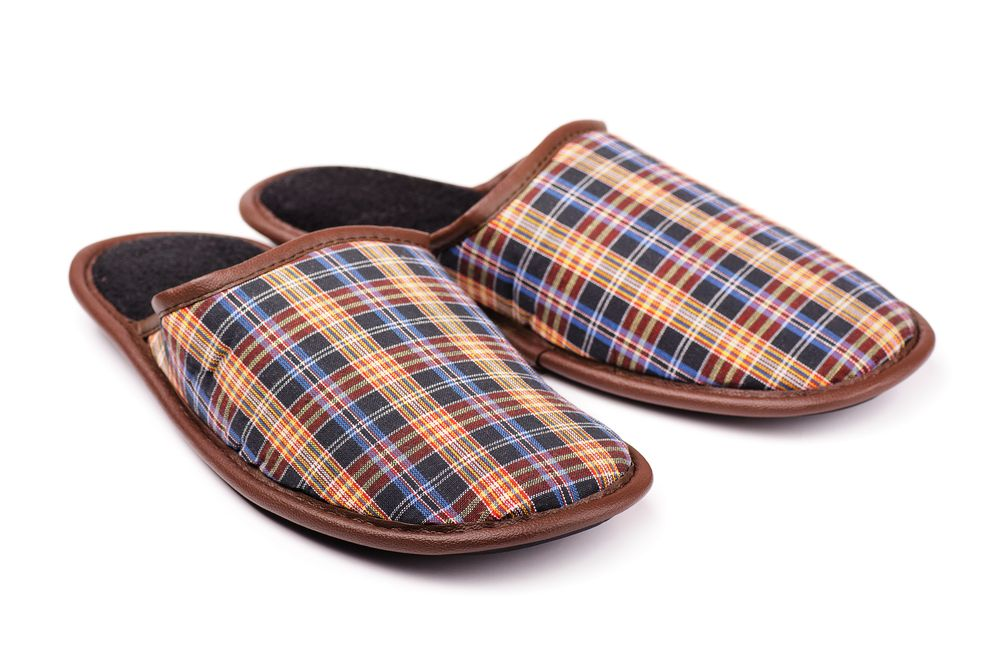
- treasure trove: [N-Count] if you describe something or someone as a `treasure trove of` a particular thing, you mean that they are a very good or rich source of that thing. (为某物提供丰富来源的)宝库 [usually singular] 
 [N-Count] you can refer to a collection of valuable objects as a `treasure trove`. (有价值物品的)宝藏 [usually singular] 
 Treasure Trove Unit: 英国宝藏部门 find a treasure trove: 找宝藏 unclaimed treasure trove: 无主财物 a treasure trove of information: 信息宝库
- convention: [N-Var] a `convention` is a way of behaving that is considered to be correct or polite by most people in a society. 习俗;惯例;常规 
 [N-Count] in art, literature, or the theater, a `convention` is a traditional method or style. (艺术、文学、戏剧中的)传统做法,传统风格 
 [N-Count] a `convention` is an official agreement between countries or groups of people. (国家或组织间的)公约,协定,协约 
 [N-Count] a `convention` is a large meeting of an organization or political group. (组织、政治团体的)大会,大型会议 
 convention center: 会展中心;会议中心;国际会展中心 national convention: 国民公会;国民大会;全国党代表大会;全国大会 Hague Convention: 海牙公约 Universal Copyright Convention: 世界版权公约;国际版权公约;万国版权公约 Basel Convention: 巴塞尔公约
- ingest: [Verb] when animals or plants `ingest` a substance, they take it into themselves, for example by eating or absorbing it. 摄取;吸收(食物、药物或信息、知识等) [technical] 
 ingest water: 吸水 Clip ingest: 素材摄取 to ingest food: 摄取食物
- conquer: [Verb] if one country or group of people `conquers` another, they take complete control of their land. 占领;征服 
 [Verb] if you `conquer` something such as a problem, you succeed in ending it or dealing with it successfully. 克服;攻克 
 Command & Conquer: 命令与征服;号令与征服 Divide and conquer: 分治法;分而治之;分治 conquer the world: 打天下;征服世界 I conquer: 我过关斩将
- irregular: [Adjective-Graded] if events or actions occur at `irregular` intervals, the periods of time between them are of different lengths. 不定时的;不定期的 
 [Adjective-Graded] something that is `irregular` is not smooth or straight, or does not form a regular pattern. 不规则的;不平整的;不直的 
 [Adjective-Graded] `irregular` behavior is dishonest or not in accordance with the normal rules. (行为)欺骗性的,不正当的,不合常规的 
 [Adjective] an `irregular` verb, noun, or adjective has different forms from most other verbs, nouns, or adjectives in the language. for example, 'break' is an irregular verb because its past form is 'broke', not 'break-ed'. (动词、名词或形容词)不规则的 
 [Adjective] `irregular` troops do not belong to an official national army. (部队)非正规的 
 irregularly shaped: 不规则形状的;形状不规则的 irregularly scheduled activities: 不定期举行的活动;不定期的活动
- ditto: in informal English, you can use `ditto` to represent a word or phrase that you have just used in order to avoid repeating it. in written lists, `ditto` can be represented by ditto marks - the symbol " - underneath the word that you want to repeat. 同上 (可用同上符号(")表示) 
 ditto mark: 同上符号 do ditto: 同上 say ditto to: 同意;对...表示同意
- thrilling: [Adjective-Graded] something that is `thrilling` is very exciting and enjoyable. 扣人心弦的;激动人心的;引人入胜的 
 a thrilling experience: 一种令人激动的经历;一种使人激动的阅历 thrilling eve: 夜幕惊魂 thrilling scene: 惊险场面 thrilling day: 震撼人心的一天
- fierce: [Adjective] a `fierce` animal or person is very aggressive or angry. 凶猛的;狂怒的 
 [Adjective] `fierce` feelings or actions are very intense or enthusiastic, or involve great activity. (感情或行动)激烈的,狂热的 
 [Adjective] `fierce` conditions are very intense, great, or strong. 极度的;巨大的;强烈的 
 (Fierce) 菲尔斯 (人名)
- intimidating: [Adjective] if you describe someone or something as `intimidating`, you mean that they are frightening and make people lose confidence. 令人惊恐的;骇人的;令人胆怯的 [usually Adjective Noun] 
 a bit intimidating: 让人有点惶恐 intimidating strike: 威吓攻击
- amid: [Prep] if something happens `amid` noises or events of some kind, it happens while the other things are happening. 在...过程中;在...中 
 [Prep] if something is amid other things, it is surrounded by them. 在...中间;在...之中 [literary] 
 amid the falling snow: 飘雪之中 amid the ruins: 废墟之中;身处废墟 amid evil: 邪恶之中 relax amid bamboos: 竹林小憩 amid fire and thunder: 轰轰烈烈 
 (Amid) 阿米德 (人名)
- surgeon: [N-Count] a `surgeon` is a doctor who is specially trained to perform surgery. 外科医生🧑‍⚕️,外科医师 
 plastic surgeon: 整形外科医生;美容整形师;整容医生 
 
- corruption: [N-Uncounted] `corruption` is dishonesty and illegal behavior by people in positions of authority or power. 腐败;贪污;受贿 
 [N-Count] in linguistics, a `corruption` is a word that is derived from an earlier word, but which has become changed in some way. (单词的)变体 [technical] (usually Noun of Noun) 
 On Generation and Corruption: 论产生和毁灭 corruption reporting center: 举报中心 Anti-Corruption: 反贪;廉政风暴 memory corruption: 内存破坏;内存损坏;内存崩溃;记忆体错误
- dominate: [Verb] to `dominate` a situation means to be the most powerful or important person or thing in it. 在...中占首要地位,在...中最具影响力 
 [Verb] if one country or person `dominates` another, they have power over them. 控制;统治;支配 
 [Verb] if a building, mountain, or other object `dominates` an area, it is so large or impressive that you cannot avoid seeing it. 俯视;高耸于 
 let one color dominate: 让一种色彩占主导色调 dominate mind: 支配意识 dominate market: 占据市场主导地位;主宰市场 dominate the market: 欺行霸市
- sober: [Adjective] when you are `sober`, you are not drunk. 清醒的;没喝醉的 [usually verb-link Adjective] 
 [Adjective] a `sober` person is serious and thoughtful. 严肃的;审慎的;头脑清醒的 
 [Adjective] `sober` colors and clothes are plain and rather dull. (颜色、衣服)素淡的,素净的,古板的 
 drunk and sober: 醉汉与清醒者 more sober moments: 规矩的片刻 sober down: 清醒过来;清醒下来 sober up: 清醒点;醒酒;使清醒起来 sober-up tea: 醒酒茶 
 (Sober) 索伯 (人名)
- back off: [Phrasal Verb] if you `back off`, you move away in order to avoid problems or a fight. (为避免问题或冲突而)后退,避让,退缩 
 [Phrasal Verb] if you `back off from` a claim, demand, or commitment that you made earlier, or if you back off it, you withdraw it. 放弃,收回(主张、要求、承诺等) 
 [Phrasal Verb] if you tell someone to `back off`, you are telling them to stop interfering. 别插手;别干涉 [informal]
- cracker: [Noun-Count] a `cracker` is a thin, crisp biscuit which is often eaten with cheese. (常配干酪🧀一起吃的)薄脆饼干 
 [Noun-Count] if you say that someone or something is a `cracker`, you like and admire them very much. 有魅力的人;令人喜爱的事物 [British, informal] 
 [Noun-Count] a `cracker` is a hollow cardboard tube covered with colored paper. crackers make a loud noise when they are pulled apart and usually contain a small toy and a paper hat. in Britain, they are used mainly at Christmas. 彩色爆竹,彩色拉炮(在英国🇬🇧主要用于圣诞节🎄,通常装有小玩具和纸帽) 
 [Adjective] if you say that someone is `crackers`, you think they are crazy or are behaving as if they are crazy. 疯狂的;发狂的 [British, informal] 
 rice cracker: 米果;脆米饼;大米薄脆饼 soda cracker: 苏打饼干;苏打脆饼;梳打饼;纯碱饼干 software cracker: 软件骇客 cream cracker: 奶油薄脆饼干;奶油梳打饼干;奶油苏打饼干 nut cracker: 坚果破壳器,坚果脱壳机;胡桃钳
- ricotta: [Noun-Uncounted] `ricotta` is a soft, white, unsalted cheese made from sheep's milk. 羊奶乳清干酪(意大利🇮🇹乳清干酪🧀) 
 ricotta cheese: 意大利乳清干酪;乳清干酪;乳清奶酪 cheese ricotta: 利可达芝士 Italian ricotta: 意大利乳清干酪
- laksa: [Noun] in Malaysia, a dish of Chinese origin consisting of rice noodles served in curry or hot soup. 马来西亚叻沙;源于中国的一道菜,主料为米线,配以咖喱汤或热汤 
 curry laksa: 咖喱叻沙 laksa leaf: 叻沙叶
- ottoman: [Noun-Count] an `ottoman` is a low, padded seat similar to a couch but without a back or arms. (无靠背、无扶手的)长软椅 
 [Noun-Count] an `ottoman` is a low, padded stool that you can rest your feet on when you are sitting in a chair. 软垫搁脚凳 
 [Adjective] of or relating to the Ottomans or the Ottoman Empire. 奥斯曼帝国的 [history] 
 Ottoman Dynasty: 奥斯曼王朝 the Ottoman Empire: 奥图门帝国;奥斯曼帝国;鄂图曼土耳其帝国
- flounder: [Verb] if something `is floundering`, it has many problems and may soon fail completely. 深陷困境;困难重重 
 [Verb] if you say that someone `is floundering`, you are criticizing them for not making decisions or for not knowing what to say or do. 踌躇;不知所措 [disapproval] 
 [Verb] if you `flounder` in water or mud, you move in an uncontrolled way, trying not to sink. (在水中或泥里)挣扎 [also Verb] 
 [Noun-Var] a `flounder` is a flat fish that you can eat. 比目鱼 
 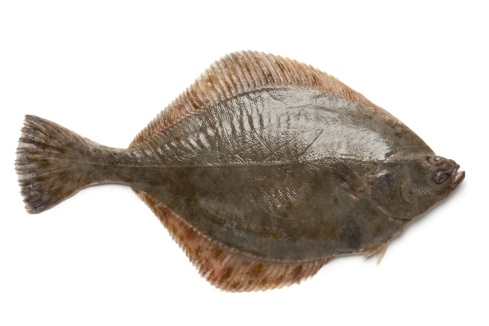
- mussel: [Noun-Count] `mussels` are a kind of shellfish that you can eat from their shells. 贻贝;蚝🦪;淡菜;蚌 
 mussel pearl: 淡水珍珠 pearl mussel: 珍珠贻贝;珍珠蚌 blue mussel: 蓝青口;紫贻贝;蓝贻贝 fresh water mussel: 河蚌 common mussel: 紫贻贝 
 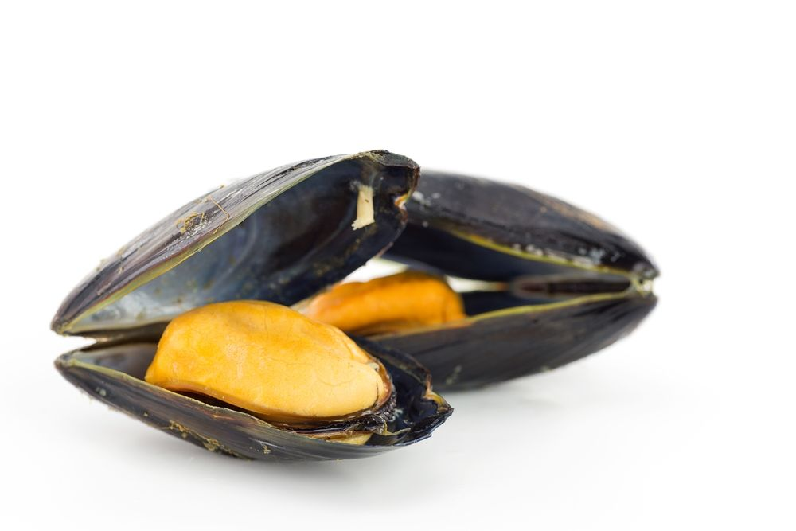
- sanitize: [Verb] to `sanitize` an activity or a situation that is unpleasant or unacceptable means to describe it in a way that makes it seem more pleasant or more acceptable. 美化;净化 
 to sanitize: 净化 to sanitize waste: 如何清洁废物
- appeal: [Verb] if you `appeal to` someone `to` do something, you make a serious and urgent request to them. 呼吁;恳请;恳求 
 [Noun-Count] an `appeal` is a serious and urgent request. 呼吁;恳请;恳求 
 [Noun-Count] an `appeal` is an attempt to raise money for a charity or for a good cause. (为慈善或正义事业的)募捐 
 [Verb] if you `appeal to` someone in authority against a decision, you formally ask them to change it. in British English, you `appeal against` something. in American English, you `appeal` something. 上诉;申诉 
 [Noun-Var] an `appeal` is a formal request for a decision to be changed. 上诉;申诉 
 [Verb] if something `appeals to` you, you find it attractive or interesting. 对...有吸引力;使感兴趣 [also Verb] 
 [Noun-Uncounted] the `appeal` of something is a quality that it has which people find attractive or interesting. 吸引力;感染力 
 appeal to: 呼吁;诉诸 court of appeal: 上诉法院;上诉庭 appeal play: 促请裁决;申述行动 appeal to emotion: 诉诸情感;诉诸情绪;煽情 appeal body: 上诉机构 
 sex appeal: 性感;吸引力 have appeal: 引人入胜,有吸引力,有魅力
- wonderland: [Noun-Count] you can refer to a place as a `wonderland` when it is strange and very beautiful or exciting. 非常奇妙的地方;极美丽的地方 [usually singular, usually with supplement, oft Noun of N] 
 [Noun-Uncounted] `wonderland` is an imaginary world that exists in fairy stories. (童话中的)仙境,奇境 
 Alice in wonderland: 爱丽丝梦游仙境;爱丽丝梦游奇境 winter wonderland: 冬日仙境
- aphrodisiac: [Noun-Count] an `aphrodisiac` is a food, drink, or drug which is said to make people want to have sex. 催情剂;春药;壮阳剂 
 also considered an aphrodisiac: 也作为春药
- basement: [Noun-Count] the `basement` of a building is a floor built partly or completely below ground level. 地下室;地下层 
 basement parking: 地下停车场;地下车库;地下泊车场 
  bargain-basement: [Adjective] if you refer to something as a `bargain basement` thing, you mean that it is cheap and not very good quality. 廉价的;劣质的;拿不出手的 (廉价区,商店内的一个区域,特别是位于地下的区域)
- trail: [Noun-Count] a `trail` is a rough path across open country or through forests. 乡间小路;林间小道 
 [Noun-Count] a `trail` is a route along a series of paths or roads, often one that has been planned and marked out for a particular purpose. (特定)路线,路径 
 [Noun-Count] a `trail` is a series of marks or other signs of movement or other activities left by someone or something. (一串)痕迹,足迹,踪迹 [usually singular] 
 [Verb] if you `trail` someone or something, you follow them secretly, often by finding the marks or signs that they have left. 跟踪;追踪;追猎 
 [Noun-Count] you can refer to all the places that a politician visits in the period before an election as their campaign `trail`. (竞选)巡游路线 
 [Verb] if you `trail` something or it `trails`, it hangs down loosely behind you as you move along. (使)拖在后面;(使)下垂;(使)曳地 
 [Verb] if someone `trails` somewhere, they move there slowly, without any energy or enthusiasm, often following someone else. (常指跟着别人)拖沓行走,没精打采地走 
 [Verb] if a person or team in a sports match or other contest `is trailing`, they have a lower score than their opponents. (比分)落后 
 [Phrase] if you are `on the trail of` a person or thing, you are trying hard to find them or find out about them. 追踪;寻找 
 freedom trail: 自由之路;自由步道;自由小径 MacLehose trail: 麦理浩径 audit trail: 审计追踪;审计跟踪;审计线索;审核线索 broken trail: 义薄情天;残破的痕迹 Lantau Trail: 凤凰径 
 (Trail) 特雷尔 (人名)
- nook: [Noun-Count] a `nook` is a small and sheltered place. 小角落;隐蔽处;偏僻处 
 if you talk about every `nook and cranny` of a place or situation, you mean every part or every aspect of it. 每个角落;到处 [emphasis] 
 song of nook: 角落之歌 the book nook: 书店 nook cafe: 角落咖啡 breakfast nook: 早餐角;早餐桌 
  nooky: [Noun-Uncounted] you can refer to sexual intercourse as `nookie`. some people consider this word offensive. 性交(有些人认为此词具冒犯意味) [informal] 
  [Adjective] 多角隅的
- intermediary: [Noun-Count] an `intermediary` is a person who passes messages or proposals between two people or groups. 调解人;中间人 
 financial intermediary: 金融中介机构;金融中介 intermediary bank: 中间行;中间银行;中转行 intermediary agent: 中介;中介机构;媒介 intermediary agency: 中介机构;中介代理
- messy: [Adjective] a `messy` person or activity makes things dirty or untidy. 邋遢的;弄脏的 
 [Adjective] something that is `messy` is dirty or untidy. 混乱的;肮脏的;凌乱的 
 [Adjective] if you describe a situation as `messy`, you are emphasizing that it is confused or complicated, and therefore unsatisfactory. (局面)混乱而复杂的,棘手的,难以应付的 
 the messy room: 凌乱的房间;混乱的房间 messy hair: 头发凌乱 messy fun: 越闹越有趣 messy play: 凌乱自由玩儿
- clarity: [Noun-Uncounted] the `clarity` of something such as a book or argument is its quality of being well explained and easy to understand. (书、论点等的)清楚,清晰易懂,明晰 
 [Noun-Uncounted] `clarity` is the ability to think clearly. 思路清晰;有条理 
 [Noun-Uncounted] `clarity` is the quality of being clear in outline or sound. (轮廓、声音的)清楚,清晰 
 [Noun-Uncounted] the `clarity` of a liquid, of glass, or of the air is the degree to which it is clear. (液体、玻璃或空气的)清澈度,透明度 
 sea of clarity: 清澈海洋 clarity and neatness: 明确和整洁 
 (Clarity) 克拉里蒂 (人名)
- feedback: [Noun-Uncounted] if you get `feedback on` your work or progress, someone tells you how well or badly you are doing, and how you could improve. if you get good feedback you have worked or performed well. 反馈;反应 
 [Noun-Uncounted] `feedback` is the unpleasant high-pitched sound produced by a piece of electrical equipment when part of the signal that comes out goes back into it. (电器设备的)反馈噪音 
 positive feedback: 正反馈 feedback loop: 反馈回路;反馈环路 give feedback: 意见反馈;看法反馈;给予反馈
- miniature: [Adjective] `miniature` is used to describe something which is very small, especially a smaller version of something which is normally much bigger. 微小的; (尤指)微型的,微缩版的 
 [Phrase] if you describe one thing as another thing `in miniature`, you mean that it is much smaller (in size) or scale than the other thing, but is otherwise exactly the same. 微型的;缩微的 
 [Noun-Count] a `miniature` is a very small detailed painting, often of a person. (常指人物的)微型画,袖珍画像 
 [Noun-Count] a `miniature` is a very small bottle of strong alcohol such as whisky or brandy, and usually contains enough for one or two drinks. 小瓶装烈酒 
 in miniature: 小型;小规模 miniature golf: 小型高尔夫游戏
- lookalike: [Noun-Count] a `lookalike` is someone who has a very similar appearance to another person, especially a famous person. 酷似...的人(尤指貌似名人者) 
 lookalike audiences: 相似受众 lookalike targeting: 类似受众定向
- perk: [Noun-Count] `perks` are special benefits that are given to people who have a particular job or belong to a particular group. 补贴;津贴;额外待遇 [usually plural] 
 central perk: 中央公园咖啡馆;中央咖啡馆;中央公园咖啡厅 perk coffee: 迈咖啡 central perk cafe: 咖啡馆 perk trees: 技能树 perk up: 振作精神;活跃起来;重新振作起来 slow perk: 缓慢学习 
 (Perk) 珀克 (人名)
- clam: [Noun-Count] `clams` are a kind of shellfish which can be eaten. 蛤;蚌;蛤蜊 
 [Verb] to gather clams. 抓蛤蜊 [American English] 
 clam soup: 蛤蜊汤;蛤仔汤 clam up: 住口;拒不开口;守口如瓶;沉默不语
 
- aim: [Verb] if you `aim for` something or `aim to` do something, you plan or hope to achieve it. 致力于;旨在;以...为目标🎯 [US, informal] 
 [Noun-Count] the `aim` of something that you do is the purpose for which you do it or the result that it is intended to achieve. 目的;目标 
 [Verb-Passive] if an action or plan `is aimed at` achieving something, it is intended or planned to achieve it. 旨在;目的是 
 [Verb] if you `aim to` do something, you decide or want to do it. 决定;想要 [US, informal] 
 [Verb] if your actions or remarks `are aimed at` a particular person or group, you intend that the person or group should notice them and be influenced by them. (行为、言论)针对,指向 [usually passive] 
 [Verb] if you `aim` a weapon or object `at` something or someone, you point it towards them before firing or throwing it. 瞄准;对准 [also Verb] 
 [N-Sing] your `aim` is your skill or action in pointing a weapon or other object at its target. 瞄准,对准(指技巧或动作) 
 [Verb] if you `aim` a kick or punch at someone, you try to kick or punch them. 踢向;挥(拳)向 [also Verb n] 
 [Phrase] when you `take aim`, you point a weapon or object at someone or something, before firing or throwing it. 瞄准;对准 
 [Phrase] if you `take aim at` someone or something, you criticize them strongly. 激烈地批评 [US] 
 aim at: 瞄准;针对;目的在于;企图 aim of: 瞄准;旨在;致力于 aim to do: 指望做某事 take aim: 瞄准;设立目标;调整高低方位 aim high: 力争上游;胸怀大志;志向远大;少年使命 aim at doing sth: 下定目标做某事;旨在做某事;目的在于做某事;目的是做某事
- hassle: [Noun-Var] a `hassle` is a situation that is difficult and involves problems, effort, or arguments with people. 麻烦;困难;争吵 [informal] 
 [Verb] if someone `hassles` you, they cause problems for you, often by repeatedly telling you or asking you to do something, in an annoying way. 烦扰;纠缠 [informal] 
 the homework hassle: 作业的烦恼 what a big hassle: 一个大麻烦;真是个麻烦事 daily hassle: 生活琐事 less hassle: 省了很多事 castle hassle: 射击类 
 (Hassle) 哈斯勒 (人名)
- outlaw: [Verb] when something `is outlawed`, it is made illegal. 宣布...为非法;使成为非法 
 [Noun-Count] an `outlaw` is a criminal who is hiding from the authorities. 逃犯;亡命之徒 [old-fashioned] 
 the outlaw: 歹徒 outlaw man: 奥特洛人 outlaw country: 亡命之徒乡村音乐;法外乡村 
 (Outlaw) 奥特洛 (人名)
- cuddle: [Verb] if you `cuddle` someone, you put your arms round them and hold them close as a way of showing your affection. 拥抱;搂抱 
  cuddle up: [Phrasal Verb] if you `cuddle up to` someone, you sit or lie as near to them as possible. 紧靠...而坐(或躺下);依偎 [also Verb Preposition] 
  cuddle up under the bridge: 依偎桥下 cuddle up with a book: 曲着身体认真地阅读一本书 we cuddle up together: 我们拥抱在一起
- shareholder: [Noun-Count] a `shareholder` is a person who owns shares in a company. 股票持有人;股东 [business] 
 controlling shareholder: 控股股东;持有控股权的股东 shareholder value: 股东价值;股东利益;股东增值 major shareholder: 大股东;主要股东 significant shareholder: 重要股东;持有大量股票的股东
- yap: [Verb] if a small dog `yaps`, it makes short loud sounds in an excited way. (小狗)狂吠,汪汪乱叫 
 [Verb] if you say that someone `yaps`, you mean that they talk continuously in an annoying way. 哇啦哇啦地说个不停;瞎扯 [informal]
- roulette: [N-Uncounted] `roulette` is a gambling game in which a ball is dropped onto a wheel with numbered holes in it while the wheel is spinning round. the players bet on which hole the ball will be in when the wheel stops spinning. 轮盘赌 
 Russian roulette: 俄罗斯转盘 Vegas roulette: 拉斯维加斯轮盘 live roulette: 现场轮盘 roulette wheel: 轮盘;赌盘 
 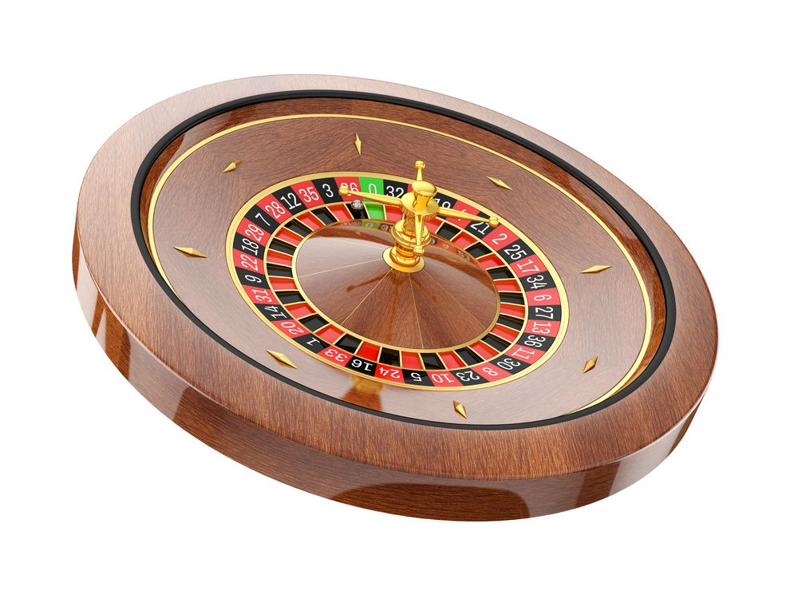
- onigiri: rice ball, is a Japanese food made from white rice. 日式饭团🍙 
 onigiri live wallpaper: 超可爱饭团动态壁纸 onigiri escape: 饭团大逃亡
- cheer: [Verb] when people `cheer`, they shout loudly to show their approval or to encourage someone who is doing something such as taking part in a game. 喝彩;欢呼 
 [Verb] if you `are cheered by` something, it makes you happier or less worried. 鼓舞;使鼓起精神 
 [N-Uncounted] `cheer` is a feeling of cheerfulness. 欢快;愉快的情绪 
 [Convention] people sometimes say '`cheers`' to each other just before they drink an alcoholic drink. (祝酒语)干杯,干 [mainly British, formulae] 
 [Convention] some people say '`cheers`' as a way of saying 'thank you' or 'goodbye'. 谢谢;再见 [British, informal, formulae] 
 cheer up: 高兴起来;振作起来;使高兴 cheer team: 拉拉队 cheer on: 声援;激励,鼓励,为某人打气 cheer sound: 助威声 cheer you up: 让你振作起来,让你开心起来 
 (Cheer) 舍尔 (人名)

#### Tattoo & tobacco

- tattoo: [N-Count] a `tattoo` is a design that is drawn on someone's skin using needles to make little holes and filling them with colored dye. 文身;刺青 
 [Verb] if someone `tattoos` you, they give you a tattoo. 给...文身;在...身上刺花纹 
 [N-Count] a military `tattoo` is a public display of exercises and music given by members of the armed forces. (军队的)表演操 [British] 
 [N-Count] if you beat a `tattoo`, you hit something quickly and repeatedly. 快速的击打;不停的敲击 [usually singular]
- tobacco: [N-Mass] `tobacco` is dried leaves which people smoke in pipes, cigars, and cigarettes. you can also refer to pipes, cigars, and cigarettes as a whole as tobacco. 烟叶;烟草(制品) 
 [N-Uncounted] `tobacco` is the plant from which tobacco is obtained. 烟草植株 
 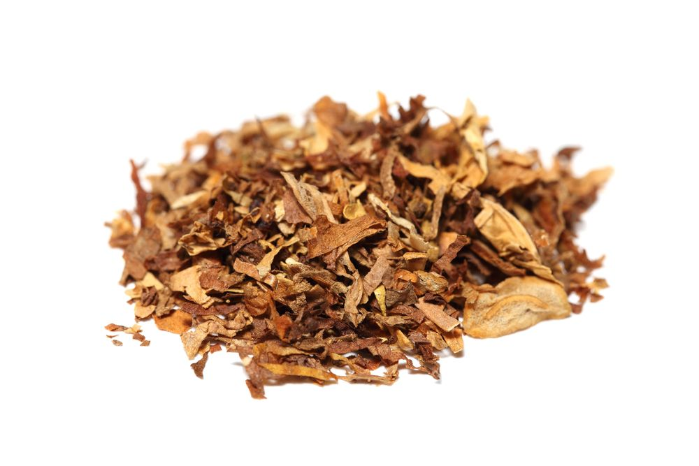

### [Inoreader](https://www.innoreader.com/)

- retaliation: [N] action taken in return for an injury or offense. 报复;反击 
  retaliate: [Verb] if you `retaliate` when someone harms or annoys you, you do something which harms or annoys them in return. 报复;反击 [also + for]
- widespread: [Adj-graded] something that is `widespread` exists or happens over a large area, or to a great extent. 普遍的;广泛的
- outage: [N-Count] an `outage` is a period of time when the electricity supply to a building or area is interrupted, for example because of damage to the cables. 停电期 [US] 
  in BRIT, use `power cut`.
- documentary: [N-Count] a `documentary` is a television or radio program, or a film, which shows real events or provides information about a particular subject. (电视、广播等)纪实节目;纪录片 
  [Adj.] `documentary` evidence consists of things that are written down. (证据)有文件记录的,来源于文件的,书面的
- figure: [N-Count] a `figure` is a particular amount expressed as a number, especially a statistic. 数字; (尤指)统计数字 
  [N-Count] a figure is any of the ten written symbols from 0 to 9 that are used to represent a number. (0 到 9 的)数字符号,数目字 
  [N-Plural] an amount or number that is in single `figures` is between zero and nine. an amount or number that is in double `figures` is between ten and ninety-nine. you can also say, for example,
  that an amount or number is in three `figures` when it is between one hundred and nine hundred and ninety-nine. 位数 
  [N-Count] you refer to someone that you can see as a `figure` when you cannot see them clearly or when you are describing them. 人影;身影 
  [N-Count] in art, a `figure` is a person in a drawing or a painting, or a statue of a person. (绘画作品中的)人物;雕像;塑像 
  [N-Count] your `figure` is the shape of your body. 体形;身材 
  [N-Count] someone who is referred to as a `figure` of a particular kind is a person who is well-known and important in some way. 知名人士;重要人物 
  [N-Count] if you say that someone is, for example, a mother `figure` or a hero `figure`, you mean that other people regard them as the type of person stated or suggested. (某种)人物,形象 [usually n Noun] 
  [N-Count] in books and magazines, the diagrams which help to show or explain information are referred to as `figures`. (书、杂志等中的)图,表 
  [N-Count] in geometry, a `figure` is a shape, especially a regular shape. (尤指规则的几何)图形 [technical] 
  [Verb] if you `figure` that something is the case, you think or guess that it is the case. 认为;猜想;估计 [informal] 
  [Verb] if you say '`That figures`' or '`It figures`', you mean that the fact referred to is not surprising. 不奇怪;很正常;合乎情理 [informal] 
  [Verb] if a person or thing `figures in` something, they appear in or are included in it. 出现,包括(在...中) [no passive, also V + as] 
  [Phrasal verb] if you `figure on` something, you plan that it will happen or assume that it will happen when making your plans. 预料;料想 
  [Phrasal verb] if you `figure out` a solution to a problem or the reason for something, you succeed in solving it or understanding it. 想出;理解;弄清 
  [Phrasal verb] if you `figure up` a cost or amount, you add numbers together to get the total. 算出...的总和
- massive: [Adj-graded] something that is `massive` is very large (in size), quantity, or extent. 巨大的;庞大的;厚重的;强大的 [emphasis] 
 [Adj.] if you describe a medical condition as `massive`, you mean that it is extremely serious. (疾病)非常严重的,十分危急的
- insanity: [N-Uncounted] `insanity` is the state of being insane. 精神错乱;精神失常;疯狂 
  [N-Uncounted] if you describe a decision or an action as `insanity`, you think it is very foolish. 极端的愚蠢(行为);荒唐(事) [disapproval]
- comeback: [N-Count] if someone such as an entertainer or sports personality makes a `comeback`, they return to their profession or sport after a period away. (娱乐圈、体育明星等的)复出,东山再起 
  [N-Count] if something makes a `comeback`, it becomes fashionable again. 再度流行 
  [N-Uncounted] if you have no `comeback` when someone has done something wrong to you, there is nothing you can do to have them punished or held responsible. 因受到伤害而追究他人的责任

### other

- frame: [N-Count] the `frame` of a picture or mirror is the wood, metal, or plastic that is fitted around it, especially when it is displayed or hung on a wall. (尤指挂在墙上展示的)画框🖼️,镜框 
  [N-Count] the `frame` of an object such as a building, chair, or window is the arrangement of wooden, metal, or plastic bars between which other material is fitted, and which give the object its strength and shape. 框;架;骨架;框架 
  [N-Count] the `frames` of a pair of glasses are all the metal or plastic parts of it, but not the lenses. 眼镜框;眼镜架 [usually plural] 
  [N-Count] you can refer to someone's body as their `frame`, especially when you are describing the general shape of their body. (人体的)骨架🩻;(尤指)体形,体态 [oft poss Noun] 
  [N-Count] a `frame` of cinema film is one of the many separate photographs that it consists of. (电影🎬的)画面,镜头 
  [Adj.] a `frame` building is one in which pieces of wood form the most important part of the structure, rather than bricks or stone. (建筑)木制的,木结构的 [US] 
  [Verb] when a picture or photograph `is framed`, it is put in a frame. 给...加框 [usually passive] 
  [Verb] if an object `is framed` by a particular thing, it is surrounded by that thing in a way that makes the object more striking or attractive to look at. 给...镶边;给...做框 [usually passive] 
  [Verb] if someone `frames` something such as a set of rules, a plan, or a system, they create and develop it. 创设,拟定,制定(规则、计划或体系) [written] 
  [Verb] if someone `frames` something in a particular style or kind of language, they express it in that way. 表达;表示 [also Verb n preposition / adverb] 
  [Verb] if someone `frames` an innocent person, they make other people think that that person is guilty of a crime, by lying or inventing evidence. 作伪证;陷害;诬陷 [informal] 
  [Phrase] if someone is `in the frame for` something such as a job or position, they are being considered for it. 在...考虑范围内;有机会成为...
- spotlight: [N-Count] a `spotlight` is a powerful light, for example in a theater, which can be directed so that it lights up a small area. 聚光灯 
  [Verb] if something `spotlights` a particular problem or situation, it makes people notice it and think about it. 使受关注;使突出醒目 
  [Phrase] someone or something that is `in the spotlight` is getting a great deal of public attention. 成为公众关注的焦点;受到瞩目 
  [Phrase] if someone or something comes `under the spotlight`, they are thoroughly examined, especially by journalists and the public. 备受(媒体和公众的)关注 [Phrase after verb]
- debit: [Verb] when your bank `debits` your account, money is taken from it and paid to someone else. 记入(账户)的借方 
  [N-Count] a `debit` is a record of the money taken from your bank account, for example when you write a cheque. (银行账户的)借记,借入
- mung: [Verb] to process (computer data) [slang] 处理(计算机数据) [俚语] 
 [N] 绿豆; (Mung) 蒙 (人名) 
  mung bean: 绿豆; mung bean soup: 绿豆汤,绿豆稀饭; mung bean noodle: 粉丝,绿豆阔面; mung bean porridge: 绿豆粥
- settle: [Verb] if people `settle` an argument or problem, or if something `settles` it, they solve it, for example by making a decision about who is right or about what to do. 解决,结束(争端、纠纷) 
 [Verb] if people `settle` a legal dispute or if they `settle`, they agree to end the dispute without going to a court of law, for example by paying some money or by apologizing. 庭外和解 
 [Verb] if you `settle` a bill or debt, you pay the amount that you owe. 付清(欠款);结算(账单🧾);结(账) 
 [Verb] if something `is settled`, it has all been decided and arranged. 决定;确定;安排好 [usually passive] 
 [Verb] to `settle` money `on` someone means to formally give it to them, for example in a will. (以遗嘱等正式方式)赠予,授予 [formal] 
 [Verb] when people `settle` a place or in a place, or when a government `settles` them there, they start living there permanently. 在...定居;使定居;把...安置在 
 [Verb] if you `settle yourself` somewhere or `settle` somewhere, you sit down or make yourself comfortable. (使)坐下;(使)处于舒适的位置 
 [Verb] if something `settles` or if you `settle` it, it sinks slowly down and becomes still. (使)缓慢沉落;(使)逐渐下陷 
 [Verb] if your eyes `settle on` or `upon` something, you stop looking around and look at that thing for some time. (目光)落在...上,注视着 
 [Verb] when birds or insects `settle on` something, they land on it from above. (鸟、昆虫)降落,栖息 
 [N] a seat, for two or more people, usually made of wood with a high back and arms, and sometimes having a storage space in the boxlike seat. 高背长靠椅 
 (Settle) 塞特尔 (人名)
- tremendous: [Adj-graded] you use `tremendous` to emphasize how strong a feeling or quality is, or how large an amount is. 巨大的;极大的;大量的 [informal, emphasis] 
 [Adj-graded] you can describe someone or something as `tremendous` when you think they are very good or very impressive. 精彩的;出色的;极好的 [informal] 
  tremendously: [Adverb] extremely. 非常地,极其,惊人地;可怕地
- dash: [Verb] if you `dash` somewhere, you run or go there quickly and suddenly. 飞奔;猛冲 
 [Verb] if you say that you have to `dash`, you mean that you are in a hurry and have to leave immediately. 马上离开;赶紧走 [informal] (no cont) 
 [N-Count] a `dash of` something is a small quantity of it which you add when you are preparing food or mixing a drink. (往食物或饮料里添加的)少量,少许 
 [N-Count] a `dash of` a quality is a small amount of it that is found in something and often makes it more interesting or distinctive. (某种特质的)少量,些许 
 [Verb] if you `dash` something `against` a wall or other surface, you throw or push it violently, often so hard that it breaks. (朝墙上等)猛摔,猛掷,猛撞 [literary] (also Verb n preposition) 
 [Verb] if an event or person `dashes` someone's hopes or expectations, it destroys them by making it impossible that the thing that is hoped for or expected will ever happen. 使(希望或期望)破灭 [journalism, literary] 
 [N-Sing] if you do something in `a dash`, you do it very quickly, perhaps with very bad results. 急匆匆;仓促 
 [N-Count] a `dash` is a short fast race. 短跑(比赛) [US] 
 [N-Count] a `dash` is a straight, horizontal line used in writing, for example to separate two main clauses whose meanings are closely connected. 破折号 
 [Exclamation] you can say `dash` or `dash it` or `dash it all` when you are rather annoyed about something. 该死;可恶;讨厌 [British, informal, old-fashioned, feelings] 
 [N-Count] the `dash` of a car is its `dashboard`. (汽车的)仪表板 
 [N-Uncounted] `dash` is a mixture of stylishness, enthusiasm, and courage. 潇洒;闯劲;勇猛 [old-fashioned] 
 [Phrase] if you say that someone `cuts a dash`, you mean that they have an attractively stylish appearance or a rather bold manner. 风度翩翩;大胆出位 [old-fashioned] (Verb inflects) 
 [Phrase] if you `make a dash for` a place, you run there very quickly, for example to escape from someone or something. (为逃离等而)飞速奔向,猛冲向 
 [Phrasal Verb] if you `dash off to` a place, you go there very quickly. 迅速前往 
 [Phrasal Verb] if you `dash off` a piece of writing, you write or compose it very quickly, without thinking about it very much. 急速写好;匆匆写成 
 (Dash) 达什 (人名)
- quickening: [N] the stage of pregnancy at which the mother first feels the movements of the fetus. 胎动(尤指孕妇初次感到的胎儿活动) 
 [V-T/V-I] if something `quickens` or if you `quicken` it, it becomes faster or moves at a greater speed. 加速,加快 
 [Adjective] the process of showing signs of life. 使复苏的
- outlet: [N-Count] an `outlet` is a shop or organization which sells the goods made by a particular manufacturer. 经销店;专营店 
 [N-Count] an `outlet` or an `outlet store` is a place which sells slightly damaged or outdated goods from a particular manufacturer, or goods that it made in greater quantities than needed. 廉价商品经销店;折扣店 
 [N-Count] if someone has an `outlet for` their feelings or ideas, they have a means of expressing and releasing them. (情感的)发泄途径;(思想的)表达方式 
 [N-Count] an `outlet` is a hole or pipe through which liquid or air can flow away. 出口;排放管 
 [N-Count] an `outlet` is a place, usually in a wall, where you can connect electrical devices to the electricity supply. (通常指墙上的)电源插座 [mainly US] 
 in BRIT, usually use `socket`.
- squash: [Verb] if someone or something `is squashed`, they are pressed or crushed with such force that they become injured or lose their shape. 压扁;压坏;压碎 [also Verb N] 
 [Adjective] if people or things are `squashed into` a place, they are put or pushed into a place where there is not enough room for them to be. 使...挤进;把...塞进 [v-link Adjective "into" N] 
 [N-Sing] if you say that getting a number of people into a small space is `a squash`, you mean that it is only just possible for them all to get into it. 拥挤 [informal] 
 [Verb] if you `squash` something that is causing you trouble, you put a stop to it, often by force. 镇压;压制;粉碎 
 [N-Uncounted] `squash` is a game in which two players hit a small rubber ball against the walls of a court using rackets. 壁球 
 [N-Mass] `squash` is a drink made from fruit juice, sugar, and water. squash is sold in bottles in a concentrated form to which you add water. 果汁饮料(通常为浓缩瓶装,饮时掺水) [British] 
 [N-Var] a `squash` is one of a family of vegetables that have thick skin and soft or firm flesh inside. 番瓜类蔬菜 
 
- dictator: [N-Count] a `dictator` is a ruler who has complete power in a country, especially power which was obtained by force and is used unfairly or cruelly. 独裁者;专政者

> [!TIP]
> __*__:
>
> - glossary: [N-Count] a `glossary` of special, unusual, or technical words or expressions is an alphabetical list of them giving their meanings, for example
>   at the end of a book on a particular subject. 术语汇编;词汇表
